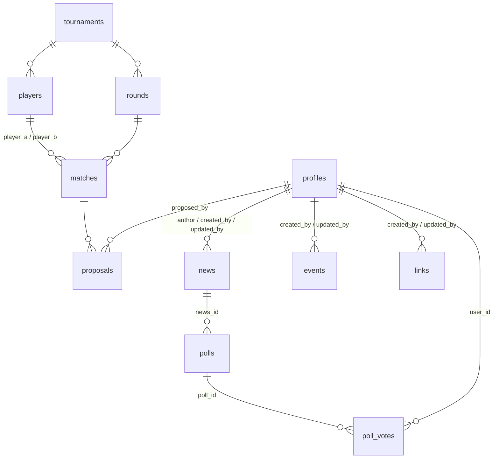

# Project state: DTHU website

**Current version: v2.37** (2026-11-13). Live: https://dthu.hu builds from this repository's
`main` (the owner moved Vercel over around 2026-11-01; checked live 2026-11-02). Every push to
`main` deploys within a minute.
**Launch phase: 1**: the public sees only the Meccsszervező; the whole site from the prototype
is built and visible to **signed-in admins** as a developer preview. See "Launch plan".

Read [CLAUDE.md](CLAUDE.md) first for how the project works. This file is the running log:
where things stand, what's next, what each release changed, and the handover between agents.

---

## Rules for agents: keep this file current

Every time you **push a change to `main`** (which deploys to production once Vercel builds this
repository):

1. **Bump the version** in the "Current version" line above:
   - `v1.0 → v1.1 → v1.2 …` for features, fixes and UI changes.
   - `v2.0` (next major) only for big redesigns or changes that need a manual step from the
     owner (e.g. a database migration), and only after agreeing it with the owner.
   - Docs-only commits (this file, CLAUDE.md, docs/, README) do **not** bump the version; note
     them under the current version instead.
2. **Add a changelog entry** at the top of "Changelog" using the template below: version,
   date, commit hash, what changed (in plain words the owner understands), manual steps,
   how you verified it.
3. **Update "Status" and "Next steps"**: move finished items out, add new ideas or debts.
4. Commit this file together with the change (or right after it), so the log never lags behind
   what's deployed.

Entry template:

```markdown
### v1.X · YYYY-MM-DD · `<commit>`
**Changed:** what users or admins notice, one bullet each
**Manual steps:** none / e.g. "run supabase/migrations/0002_….sql before deploying"
**Verified:** tests/lint/types, browser checks (desktop + phone), live check after deploy
```

---

Also at the end of **every session** (shipped or not): add a Handover log entry and keep the
feature table, owner tasks and known issues current (see CLAUDE.md → "End of every session").

---

## Launch plan

**Phase 1: the Meccsszervező in public, the rest as an admin preview.** Every page of the
prototype is built (see Features). Logged-out visitors get the registration guide (`/regisztracio`),
logged-in non-admins the Meccsszervező; admins see the full menu with a "fejlesztői előnézet" strip, on dthu.hu too.
The code is on GitHub (github.com/Davetatyo/DTHU_Website, `main` + `feature/*`), and dthu.hu has
built from `main` since about 2026-11-01 (see [docs/vercel.md](docs/vercel.md) for how it was set
up). Still open from that move: see "Needs the owner".

**Phase 2: the full site.** When the features below have real data (owner decides which are
needed for launch): set `NEXT_PUBLIC_FULL_SITE=1` in Vercel and redeploy. Everyone then sees
the site menu, "Hírek" as the home page and `/gyik` as the site FAQ (in phase 1 the public is
sent to the Meccsszervező FAQ by a temporary redirect, on purpose). Decide before then whether login and profile move
to site-level URLs (they're under `/meccsszervezo` now) and add redirects if they do.

## Features

Status values match `src/features/registry.ts`. Design and sample content for every feature is
in `reference/artifact` (open `reference/artifact/index.html`).

| Feature (folder / branch `feature/<id>`) | Route | Status | Real data / still sample | Next step |
|---|---|---|---|---|
| `match-organizer` Meccsszervező | `/meccsszervezo` | **live** | all real | features as the owner asks |
| `landing-page` Hírek (home) + news | `/`, `/hirek`, `/hirek/<slug>`, admin `/meccsszervezo/admin/hirek` | preview (admins only), **on `main` since v2.5** | news real (table `news`, migration 0004); banner + matches real; ranking and tickets sample | owner runs migration 0004, tests live after the push |
| `rankings` Ranglista | `/ranglista` | preview | names/heroes real; points, records, movement sample | results source (Karnyx copy-paste? results on "Lejátszottuk"?) |
| `timetables` Eseménynaptár (was Versenynaptár) | `/esemenynaptar` (+ `/esemenynaptar/<slug>`, admin `/meccsszervezo/admin/esemenyek`) | preview (admins only), **on `main` since v2.3** | all real: events table (migration 0003) + online rounds; sample data removed | owner tests live; then phase 5 (calendar feed, Hírek tiles, Discord later) |
| `tickets` Sorsolás (ticket draws) | `/sorsolas`, admin `/sorsolas/admin` | preview (admins only), **on `main`** (pull request #2, 2026-11-03) | all real (migration 0008 has run): ticket ledger, draws, entries, winners; podium places earn tickets (+3/+2/+1, booked by admins), and since `feature/shop` they can also be bought for DTHU coins | owner tests live |
| `games` Játékok | `/jatekok`, `/jatekok/taktikai-elony`, `/jatekok/kockazat`, `/jatekok/szemfules` | preview (admins only), **on `main` since v2.11** (Kockázat v2.13, Szemfüles v2.17, Trick or Treat v2.20, Black Friday Shopping v2.21, ARRRrrrrrrrrr v2.22) | Taktikai Előny: static data from the Szabálytár + `lib/tactician-traits.ts`; Kockázat: all in the browser. **Napi kvíz + Szerencsekerék + sorozat** (DTHU coins, admin settings, question bank, audit log) on `main` since pull request #4 (migration 0010 has run) | admins write the first questions (none yet, checked 2026-11-05); level Kvíz (R7) still parked |
| `shop` Bolt + DTHU coin | `/bolt`, admin `/bolt/admin`; wallet in the header | preview (admins only), **on `main` since pull request #3** | all real (migration 0009 has run): DTHU coin ledger; the only item is a Sorsolás ticket for 3500 coins; coins only from admins so far; header wallet (coins + tickets) shown wherever the full site is | how players earn coins (owner to describe) |
| `rulebook` Szabálytár | `/szabalytar` | preview (admins only), **RulePop version on `main` since v2.8** (roadmap R10) | the owner's Hungarian RulePop imported (36 sections, 40 heroes, 123 tokens) + the 5 newer heroes and 13 tokens translated (v2.9); popups + own links; hero boards and leaflets from the fandom wiki with a large view (v2.28, v2.29; Mystic Brawler has none yet) | owner reviews the new translations; ~20 core pages still to translate |
| `faq` GYIK (site-wide) | `/gyik` | preview | content from the prototype | review texts |
| `links` Linkek | `/linkek`, admin `/meccsszervezo/admin/linkek` | preview (admins only), **admin editor on `main` since v2.7** | links from the `links` table (migration 0006) | owner runs migration 0006, tests live |
| `alchemist` Alkimista | `/alkimista` + help vial | preview | knowledge base from the prototype; unanswered questions only in the browser | admin inbox for unanswered questions |
| `register-page` Regisztráció | `/regisztracio` | **live** | static guide content; tournament banner real | owner review of Hungarian texts |
| `live-banner` Élő adás | banner at the top of the layouts; `/api/live/voice`, `/api/live/now`; admin block on `/meccsszervezo/admin` | **on `feature/live-banner`, not merged**. Admins only until `LIVE_BANNER_ADMINS_ONLY` is false | real; migration 0011 has run; detection waits for Árpád's bot | see "Needs the owner"; `src/features/live-banner/README.md` on that branch |
| `xp` XP and levels | Profilom card, header bar, popups; admin `/meccsszervezo/admin/xp` | **step 1 on `main` since v2.31**: admins only until `XP_ADMINS_ONLY` is false | real (migration 0012 has run) | owner tests live; then step 2 (Gyűjtemény) |
| `hero-guide` Hős segédlet | `/meccsszervezo/meccs/<id>/hos-segedlet` (button on the match page) | **on `main` since v2.30**: admins only until `HERO_GUIDE_ADMINS_ONLY` is false, then everyone logged in | real; no tables | `src/features/hero-guide/README.md` |
| `puzzle` Taktikai feladvány (experiment, working title) | `/jatekok/taktikai-feladvany`, `/jatekok/taktikai-feladvany/<id>`; card on the Játékok page | **parked** (owner, 2026-11-09): only on branch `feature/puzzle`, never merged into `main` | static: Season 1 Barbarian + Moon Elf rules from the Card Scanner repo; no tables. Images are **not committed** (owner): make them locally with `scripts/puzzle/assets.py` | when picked up: fix the Blind vs. Ultimate rule first (Features_Roadmap R16, `src/features/puzzle/README.md` on the branch) |
| `profile` Profilkép, Profil szerkesztése, Kitiltás | `/meccsszervezo/profil`, `/meccsszervezo/admin/felhasznalo/<id>` | **live** (v2.2): every logged-in user can upload a picture; admin page and bans for all admins | all real | badge ring (R3/R4), cosmetics collection |

## Database (Supabase)

Snapshot of the live database, **checked 2026-11-03** against the production project
(read-only: table existence, row counts, storage buckets; migrations rechecked 2026-11-05). There is **one** Supabase project:
local development uses the live data too (see CLAUDE.md, golden rule 1).

**Migrations** (`supabase/migrations/`, run by hand in the Supabase SQL Editor, in order):
0001 init · 0002 profile pictures and bans · 0003 events · 0004 news · 0005 polls · 0006 links ·
0007 match play modes · 0008 ticket draws · 0009 DTHU coins · 0010 daily spin and question · 0011 live
banner (its code is on `feature/live-banner`) · 0012 XP. **All are applied** on the live database (checked
2026-11-05 by reading a table from each). A new change gets the next number (0013…) and is run
*before* the code that needs it is deployed.

**Access model:** row level security is on for every table. The website reads and writes
through the server with the service-role key and checks permissions in code
(`requireAdmin()` etc.). Only the 0001 tables have read policies (tournament data public,
`profiles` for signed-in users); the newer tables have **no policies**, so the browser can't
read them directly at all. There are no database functions or triggers of our own yet; migration 0008 adds five
(`ticket_award`, `ticket_draw_enter`, `ticket_draw_complete`, `ticket_draw_close_now`,
`ticket_draw_cancel`), migration 0009 two (`coin_award`, `shop_buy_tickets`) and migration 0010
five (`daily_spin`, `daily_answer`, `daily_question_for`, `daily_streak_touch`,
`economy_config_set`) plus a trigger that keeps `audit_log` unchangeable, callable only
with the service role. They keep balances >= 0 and refuse
entries after a draw closes.

### Tables

| Table | What it holds | Key columns | Rows* |
|---|---|---|---|
| `profiles` | One per Discord login (`id` = `auth.users.id`) | `discord_id`, `discord_username`, `display_name`, `karnyx_name` (unique, case-insensitive), `facebook_name`, `timezone`, `is_admin`, `avatar_path`, `banned_at`, `banned_by` | 18 |
| `tournaments` | A tournament (the online season) | `name`, `is_active` | 1 |
| `players` | Players of a tournament, from the pasted Karnyx pairings | `tournament_id`, `karnyx_name` (unique per tournament), `heroes` (text[]) | 24 |
| `rounds` | Rounds of a tournament | `tournament_id`, `number`, `starts_at`, `deadline`, `closed_at`, `completed_at`, `deadline_warning_sent` | 2 |
| `matches` | One pairing (table) in a round | `round_id`, `table_no`, `player_a_id`, `player_b_id` (null = bye), `status` (pending/proposed/confirmed/played/bye), `scheduled_at`, `played_at`, `reminder_sent` (unused), `mode_a`/`mode_b` (0007: `tts`/`webcam`/null) | 23 |
| `proposals` | Proposed times for a match | `match_id`, `proposed_by` → profiles, `starts_at`, `status` (open/accepted/declined/superseded) | 32 |
| `events` | Eseménynaptár events | `slug` (unique, never changes), `title`, `kind` (online/live/community/other), `tentative`, `starts_at`, `ends_at`, `all_day`, `location`, `summary`, `body` (jsonb blocks), `cover_path`, `link_url`, `card_only`, `pinned`, `published_at` (null = draft, future = scheduled), `created_by`/`updated_by` | 3 |
| `news` | Hírek articles | `slug`, `title`, `category` (tournament/community/live/site/shop), `lead`, `body` (jsonb blocks), `cover_path`, `pinned`, `published_at`, `edited_at`, `author_id`, `created_by`/`updated_by` | 4 |
| `polls` | Szavazás in an article (set up in the article's body, synced on save) | `id` (from the editor), `news_id` (cascade), `question`, `options` (jsonb: id + label), `multi`, `allow_other`, `closes_at` | 1 |
| `poll_votes` | One vote per user per poll (anonymous on the site) | primary key (`poll_id`, `user_id`), `choices` (text[], `_other` = Egyéb), `other_text` | 1 |
| `links` | Linkek page | `title`, `url`, `description`, `image_path`, `sort_order`, `visible` | 5 |

| `ticket_draws` *(0008)* | Sorsolás draws | `title`, `prize`, `description`, `closes_at`, `winner_count`, `max_tickets_per_player`, `status` (open/drawn/cancelled), `drawn_at` | – |
| `ticket_ledger` *(0008)* | Every ticket change; balance = sum | `profile_id`, `amount` (not 0), `kind` (award/draw_entry/draw_refund), `reason`, `draw_id`, `created_by` | – |
| `ticket_draw_entries` *(0008)* | Tickets a player put into a draw | primary key (`draw_id`, `profile_id`), `tickets` | – |
| `ticket_draw_winners` *(0008)* | Draw results | primary key (`draw_id`, `place`), `profile_id` (unique per draw) | – |
| `coin_ledger` *(0009)* | Every DTHU coin change; balance = sum. A shop purchase writes a coin row (− price) and a `ticket_ledger` row (kind `shop_purchase`, added to its allowed kinds by 0009) together | `profile_id`, `amount` (not 0), `kind` (award/shop_purchase), `reason`, `created_by` | – |
| `economy_config` *(0010)* | Economy settings edited by admins (spin table, rewards, streak, ticket price, fallback, weekday types); a missing key = the default in `shop/lib/economy.ts` | `key`, `value` (jsonb), `updated_by` | – |
| `audit_log` *(0010)* | Every admin change to settings and daily questions; update/delete refused by a trigger | `actor_id`, `action`, `entity_type`, `entity_id`, `before`, `after`, `reason` | – |
| `daily_spins` *(0010)* | One spin per player per Budapest day | `profile_id`, `day` (unique together), `result_label`, `coins` | – |
| `daily_questions` *(0010)* | Question bank | `type`, `prompt`, `answer_mode`, `options`/`correct_option` or `accepted_answers`, `explanation`, `difficulty`, `reward_override`, `status`, `publish_date` (unique), `times_used`, `last_used_date` | – |
| `daily_question_days` *(0010)* | The question each day used, fixed on first request | `day` (key), `question_id` | – |
| `daily_question_answers` *(0010)* | One answer per player per day | `question_id`, `profile_id`, `day`, `answer`, `is_correct`, `coins` | – |
| `live_channels` *(0011)* | Tournament voice channels for the Élő adás banner, edited on the admin page | `discord_channel_id` (key), `name`, `join_url`, `sort_order`, `last_report_at` | – |
| `match_live` *(0011)* | Matches that went live; whether one is live now is worked out when read | `match_id` (key, cascade), `channel_id`, `started_at`, `last_seen_at`, `ended_at`, `source` (voice/admin) | – |
| `xp_events` *(0012)* | Every XP change; total = sum | `profile_id`, `activity`, `amount`, `multiplier`, `ref` (unique with player + activity), `tournament_id`, `reason`, `given_by`, `seen_at` | – |
| `xp_activities` *(0012)* | What each activity is worth, on/off | `key`, `name`, `amount`, `active` | – |
| `xp_config` *(0012)* | Settings, e.g. the level curve | `key`, `value` (jsonb) | – |
| `xp_boosts` *(0012)* | Double XP: a tournament, or a time window for chosen activities | `multiplier`, `starts_at`, `ends_at`, `activity_keys`, `tournament_id` | – |
| `daily_streaks` *(0010)* | Days in a row per game (spin and quiz separately, 1..7) | `profile_id` + `game` (key), `current_length`, `last_completed_date` | – |

\*Row counts on 2026-11-03, for scale only.

Every table also has `created_at` (and most `updated_at`). `auth.users` (Supabase Auth,
Discord provider) is managed by Supabase; a profile is created at the first login.



### Storage buckets (all public read; writes only through the server)

| Bucket | For | Limit |
|---|---|---|
| `avatars` | Profile pictures (`profiles.avatar_path`) | 300 KB, webp/jpeg/png |
| `event-images` | Event cards and pictures in event pages | 1 MB, webp/jpeg/png |
| `news-images` | News cards and pictures in articles | 1 MB, webp/jpeg/png |
| `link-images` | Linkek tile pictures | 1 MB, webp/jpeg/png |

### Scheduled job

`pg_cron` + `pg_net`: job `dt-reminders` runs every hour and calls
`https://dthu.hu/api/cron/reminders` with the secret stored in Vault as `dt_cron_secret`
(setup in docs/setup.md §6; not re-checked here, it isn't visible through the API).

### Not in the database

Szabálytár content (files in `src/features/rulebook/content/`), the games' data (code), the
Alchemist's answers (code). Kept only in the player's browser (`localStorage`):
the Alchemist's unanswered questions, Szemfüles best scores. Ranking data is still
sample data (no tables yet; tickets and coins become real with migrations 0008 and 0009; ideas in the roadmap: R4 `xp_events`, R7
`quiz_*`).

## Needs the owner

0. **XP step 1 (v2.31, admins only; migration 0012 has run, checked 2026-11-08).** Test as an admin: mark a played match, give yourself XP on Admin felület → XP kezelés, watch the
   card, the notification and a level-up. When the full site opens: `delete from public.xp_events;`
   and set `XP_ADMINS_ONLY` to false.
0. **Élő adás (`feature/live-banner`, not merged; migration 0011 has run).** To do: add
   `LIVE_BOT_SECRET` in Vercel and redeploy if not done yet, send it privately to Árpád, merge the branch
   (the banner stays admins only), add the voice channels on the admin page, and test with Árpád once
   his bot has the reporter (`src/features/live-banner/bot/README.md`). To answer: should a short game
   stay on the banner for the full 1.5 hours (built that way), and should spectators keep it on (built:
   no)? Merging: this branch's STATE.md and roadmap repeat these notes, so keep `main`'s version.
0. **Hős segédlet (v2.30, admins only).** Test it live. To open it to everyone logged in: decide on
   Roxley's images, set `HERO_GUIDE_ADMINS_ONLY` to false, add it to the GYIK.
0. **Napi kvíz + Szerencsekerék (on `main`, migration 0010 has run):** write the first daily questions
   (Játékok → "Napi játékok kezelése" → Kérdésbank); until there is a ready question the Napi kvíz says
   "Mára nincs kérdés". None yet, checked 2026-11-05.
0. **Bolt + DTHU coin (on `main`, migration 0009 has run):** describe how players earn coins (for now
   only admins give them).
0. **Sorsolás (on `main`, migration 0008 has run):** test it live. No new cron job: the hourly
   `dt-reminders` call also holds closed draws (response becomes `{"warnings":0,"draws":0}`).
0. **Játékmód (v2.19; migration 0007 applied, checked 2026-11-03).** On dthu.hu: a match → propose with TTS → the other side accepts with
   Webkamera → Közelgő meccsek → Hibrid filter.

0. **Linkek (v2.7, on `main`; migration 0006 applied, checked 2026-11-03).** On dthu.hu: Admin felület → Linkek kezelése → Új link, picture, ↑ / ↓,
   "Látható" off, delete; check `/linkek`.
0. **Szavazás (v2.6, on `main`; migration 0005 applied, checked 2026-11-03).** On dthu.hu: a news article → "+
   Szavazás indítása" → publish → vote, change the vote, check live results (a second admin
   account helps), "Új hír az eredményből".
0. **Hírek (v2.5, migration 0004 run by the owner):** on dthu.hu as admin: Admin felület → Hírek kezelése → Új hír → card picture, blocks
   (try formatting, list, gallery, a YouTube link, an event card) → publish now / scheduled →
   check `/`, `/hirek` and the article; delete test articles afterwards.
1. **After the move to dthu.hu** (done around 2026-11-01): confirm the old `dthuonlinebajnoksag` Vercel
   project is off, then archive DT_Match_Organizer on GitHub (read-only).
2. Carried over from DT_Match_Organizer `state.md` (2026-10-30), status unknown here, please
   confirm or close:
   - Domain move to dthu.hu: Supabase Site URL `https://dthu.hu` + redirect
     `https://dthu.hu/auth/callback`; `dt-reminders` job URL → `https://dthu.hu/api/cron/reminders`;
     Vercel `NEXT_PUBLIC_SITE_URL` (optional).
   - **Security:** the two stray lines in `.env.local` (they looked like the Discord app's Client ID
     and Secret) are gone, checked 2026-11-05. If you haven't yet, reset the Discord Client Secret
     (Developer Portal → OAuth2 → Reset Secret, then paste it into Supabase → Authentication →
     Providers → Discord), since it sat in that file.
   - Link RP to his match (Admin → RP's row → "Karnyx név szerkesztése" → "RP").
   - Confirm the first swap's 🔁 Discord post appeared; ask players to log in and claim their
     Karnyx names; around 2026-10-31 12:25 confirm the automatic 48h warning appeared.
   - Optional: tag releases (`v1.0 e527783`, `v1.1 6c1a193`, `v1.2 a278e0a`) and push tags.
3. Decide the scope and order of the phase-2 features (table above) and of the future
   features in [Features_Roadmap.md](Features_Roadmap.md) (open questions per item).

## Ideas discussed, not decided (ask the owner before building)

Bigger future features (tutorial, news/event admin, profile avatars, XP, admin area, games and
quiz) are in
[Features_Roadmap.md](Features_Roadmap.md). Smaller ideas:

- Crop the logo to just the glowing dice for a clearer small icon, and use it as favicon.
- Drop the "Megerősítve" (confirmed) Discord posts entirely if the channel gets noisy.
- Split Discord posts into two channels (second webhook), or DMs via a real bot.
- Ask the Karnyx developers for a public share link or API to import pairings automatically.
  (A bookmarklet that read the Karnyx round page was tried and removed on 2026-10-30: the
  page mixes pairings with other player lists; the owner keeps the manual copy-paste.)
- Hero-colour accents (the prototype's hidden "Válassz hőst" theme menu).
- More hero artwork: only Barbarian, Paladin and Alchemist have images
  (`public/images`, listed in `src/lib/heroes.ts`); others get a gradient in their colours.

## Known issues

- The admin preview gate (middleware reads `profiles.is_admin` with the visitor's session) has no
  recorded check with a real non-admin login. The owner tests as an admin.
- Most full-site pages show sample data (see Features); the prototype strip says so.
- Discord login works locally only on port 3000 (Supabase redirect allow-list).

## Technical debt

- `matches.reminder_sent` column is unused since v1.0 (1-hour reminder removed). Remove it
  in a future migration.
- No tests for server actions, database access or end-to-end flows; only pure logic is
  unit-tested. Consider Playwright against a separate Supabase project before bigger changes.
- Only one Supabase project: local development uses production data. A separate dev
  project would make testing write actions safe (and is needed before building features with
  their own tables).
- Login and profile live under `/meccsszervezo`; at the full launch they may belong to a
  site-level account area.
- The Alchemist's rule answers still come from the prototype's summary
  (`features/rulebook/data/`); heroes and tokens already come from the Szabálytár (v2.10).
  Its rule links are mapped to the new pages (`LEGACY_SLUGS` in `features/rulebook/lib/pages.ts`).
- The old class names in `globals.css` are aliased onto the new tokens (`--surface`,
  `--accent`, …); new code should use the design tokens (`--panel`, `--gold`, …) directly.

---

## Handover log

Newest first. Each session adds an entry (see CLAUDE.md → "End of every session").

### 2026-11-13 · Hero icons in the Lista nézet (v2.37, feature/hero-icons → main)

- Owner's request: on Áttekintés → Lista, show each player's heroes as small round icons instead of
  text, and make the player avatars bigger. Shown first on a clickable localhost preview, then approved.
- `src/lib/heroes.ts`: `heroSlug()` and `heroPortrait()` (the Szabálytár's 300 px square portraits in
  `public/szabalytar/img/heroes/`, 45 heroes; test in `src/lib/heroes.test.ts`).
  `src/components/HeroIcon.tsx`: round portrait, or a circle in the hero's colours with initials;
  the name is the tooltip, the roster is the `aria-label`.
- `MatchList` rows: icons 28 px (24 px on phones), overlapping by 5 px so three fit at about 1000 px
  width; avatars 52 px on desktop (still hidden on phones); old `.mr .pl small.heroes` CSS removed.
  The Kártyák view (`MatchupGrid`) and match pages still show hero names as text.
- Known limit: on phones there's no hover, so the hero names aren't shown in the list.
- Verified: types, lint, tests; browser at 1024 px and 375 px, dark and light, real round 3 data
  (none of the 22 player slots overflow). Previewed with the TEMP-PREVIEW fake profile and middleware
  bypass, both reverted (grep clean) before the commit.

### 2026-11-09 · New DTHU logo (v2.34, then v2.35 fix)

- Owner sent a new square logo (3D "DTHU" lettering over "DICE THRONE HUNGARY"). The image already
  has a transparent background. Where it's used:
  - top bar (`SiteHeader`, `regisztracio/layout.tsx`): `.brand-logo` (`public/images/dthu-logo.webp`,
    just the DTHU lettering, unchanged) + the small "Dice Throne Hungary" text; the bold "DTHU" text is gone;
  - login card and the registration guide's last step: the same image at 128 px;
  - `src/app/icon.png`, `apple-icon.png` and `favicon.ico`: since v2.36 only the DTHU lettering on
    white, without the "Dice Throne Hungary" text (owner's request; the page logos stay as they are).
  `.brand-die` CSS is removed; `public/images/die.webp` is unused now but kept.
- v2.34 was wrong: the cut-out step read the transparent background as black and also erased the D's
  black front face (white D in light mode, black icon backgrounds); a cream outline hid it on the dark
  bar. Owner: the white edge looked awful, and **don't change the graphic**. v2.35 uses the image's own
  transparency with no outline. On the dark top bar the black sides of the D and T blend in; the owner
  chose it as is (a CSS orange glow was offered and declined).
- Verified: types, lint, tests; browser at desktop and 375 px, dark and light (top bar, login card).
- The source image isn't in the repo; ask the owner for it if the logo needs remaking.
### 2026-11-09 · Taktikai feladvány experiment, MVP, then parked (feature/puzzle)

- Owner's request: a Dice Throne puzzle game (preset board, find the solution). His answers to the
  open questions: Season 1 heroes first; the offensive roll fully preset; the defence counts every
  outcome (percentage); no defender cards in the first one; only "find lethal"; card images; name
  "Taktikai feladvány" (working title); XP and coin rewards set by admins later.
- Built on `feature/puzzle` (branched from `main` at v2.33), committed there only:
  `src/features/puzzle/` (README, rules engine, solver, puzzle 1, game component, CSS),
  pages `src/app/(site)/jatekok/taktikai-feladvany/` (list + `[id]`), `routes.puzzles`/`routes.puzzle`,
  registry entry `puzzle` (planned: no menu item), a Játékok hub card with `adminOnly`
  (`GamesHub` gets `adminView`). Images (48 cards, 12 dice faces, 2 Season 1 boards, 2.1 MB) are
  **not committed** (owner, 2026-11-09: no card images on the site yet): `public/jatekok/feladvany/`
  is in `.gitignore` on the branch; `scripts/puzzle/assets.py` makes them from the Card Scanner repo
  (only read): `python3 -I scripts/puzzle/assets.py ../Dice_Throne_Card_Scanner`.
- Engine: Barbarian and Moon Elf abilities, defences and every upgrade, read off the Season 1 boards
  and card images (the scanner's Moon Elf texts are empty, so they were read from the images).
  `resolveAttack` gives win/tie/lose chances over every roll that follows (Blind, Overpower's roll,
  Missed Me's 7,776 rolls, Evasive), with Hungarian notes. The solver tries every card play (puzzle 1:
  109 states, about 50 ms) and finds the best line. Rules it assumes are listed in the README for the
  owner to confirm.
- Puzzle 1 "Vakon is látni": the answer is Buh-Bye! on your own Blind + Six-It! → Crit Bash II (100%);
  Rage! is the trap (66.7%). A test checks the solver finds exactly that.
- Verified: `npx tsc --noEmit`, `npm run lint`, `npm test` (276 tests, 16 new). Browser (scratch
  preview with a fake admin, port 3100): the hub card shows for admins; played the solution and the
  Rage! trap through the UI (result, notes, Megoldás); 375 px phone (no sideways scroll after a grid
  fix), dark and light; Hőstábla popup.
- The owner tested it locally. For that, the puzzle opens without login on `npm run dev` only
  (`PUZZLE_OPEN_IN_DEV` in `lib/access.ts`); `NEXT_PUBLIC_FULL_SITE=1` was added to `.env.local` for the
  test and removed again afterwards.
- **Owner's finding:** he played Rage! (Ultimate) while Blind and got 66.7%. His ruling: Blind does not
  stop an Ultimate, so that line should be 100%. The engine (`resolveAttack`) assumes Blind fails the
  attack on 1–2 even for an Ultimate: that is wrong per the owner. Fixing it makes Rage! a second 100%
  answer in puzzle 1, so puzzle 1 needs a new design too.
- **Parked** (owner, 2026-11-09): stays on `feature/puzzle`, not merged into `main`. Roadmap R16 is
  marked parked (also on `main`).
- Next agent, if the owner picks it up: merge `main` into `feature/puzzle`, fix the Blind vs. Ultimate
  rule (and check the other assumed rules in the README with him), redesign puzzle 1, then ask before
  merging (no migration).

### 2026-11-08 · XP popup kept coming back on the Időpontfoglaló tab (feature/xp, v2.33)

- Owner: after closing, the popup reappeared whenever he clicked the Időpontfoglaló tab. The database
  was right (every row marked seen within seconds, checked read-only): Next.js reused an older stored
  copy of that section, from before the mark. Fix in `XpNotifier.tsx`: the browser remembers the
  newest notice it showed (`localStorage` "dthu_xp_shown", keyed by the newest XP row id) and closing
  refreshes the router's stored copies (`router.refresh()`).
- Checked in the scratch copy, where marking is blocked, so the browser guard is the only thing
  stopping a replay: shown once; not again after going to Hírek and back, after a full load, or after
  the corner card auto-closes and the Áttekintés tab is clicked. Types, lint, tests.

### 2026-11-08 · Level-up popup: several levels at once (feature/xp, v2.32)

- Owner: when XP jumps several levels (e.g. a first place), show each level being reached. Built in
  `XpNotifier.tsx`: the bar fills level by level, the number jumps with a small burst at each, chips
  for the levels light up, the XP counter climbs, the ending (title, badge, buttons) and the full
  fireworks come last; "Átugrás" skips; reduced motion jumps to the end. Driven by a 16 ms timer, not
  requestAnimationFrame, so it doesn't stall in a hidden tab.
- Checked in the scratch copy with example data (`/xpdemo/<mode>` links, scratch only): 0 → 4 and
  0 → 6 with Barbár, desktop and 375 px. Types, lint, tests. Owner approved and pushed.

### 2026-11-08 · XP step 1 (feature/xp, v2.31)

- Owner chose from mockups: Profilom card option A, XP notification "1." (corner card), level-up popup
  without the curtain reveal; badge try-on moved to the bottom of Profilom.
- Built: migration 0012 (tables, `xp_award` / `xp_admin_adjust`), `lib/levels.ts`, `lib/finishers.ts`,
  15 XP on every played match (hook in `setMatchPlayed`, never throws), admin XP page (hand XP,
  tournament XP with podium, activities, curve, double XP, one user's history), Profilom card, header
  bar, notification and level-up popup. Admins only (`XP_ADMINS_ONLY`).
- Verified: types, lint, tests (new: levels, rewards, finishers). Migration run twice on an in-memory
  Postgres with its rules checked (duplicates, inactive, both kinds of double XP, below-zero refusal).
  Preview with example data (cookie-switched, scratch copy only): card desktop + phone, notification,
  level-up with Holdtündé, admin page; found and fixed a crash where the popup rendered on the server.
- Owner ran migration 0012; checked read-only before the push: four tables, 11 activities, no XP yet.
- **Not verified:** any real write (golden rule); the "seen" marking (writes blocked in the preview, so
  there the popup shows on every page). The owner tests both live.
- The preview copy in `/private/tmp/...` lost files to the system's temp cleanup this session; it was
  rebuilt (`npm ci`, `.env.local` copied, TEMP-PREVIEW patches reapplied). Expect that again.

### 2026-11-08 · XP plan updated by the owner (roadmap only, nothing built)

- Owner's changes recorded in `Features_Roadmap.md` → R4 "Owner's update, 2026-11-08": start at level
  0, tutorial 25 XP, no first-sign-in XP, featured game of the day (5 XP), thumbs-up on news with
  optional 5 XP, targeted double XP, podium set chosen per tournament, curtain reveal for the next
  reward. Later the same day: daily quiz gives XP; built on the live database; test XP wiped and XP
  opened only with the full site; curve **+20 a level** (level 20 = 4,300 XP); **podium extra doubled**
  to 300/200/150; year two decided later. A day-by-day simulation of five player styles was shown to
  the owner (committed hybrid level 20, website-only and tournament champion 17, tournament-only 12,
  casual 11). Then, with realistic podium odds (about 20 players, ~90% never on the podium) and 6
  rounds per tournament: **15 XP for every game played** (Bye counts) replaces the first-match 10 XP,
  so a tournament is worth ~120 XP. Uncommitted.

### 2026-11-05 · STATE.md and roadmap brought up to date (docs only, under v2.30)

- Added Élő adás to `main`'s notes (it was only on its branch), corrected entries from before the move
  to dthu.hu and the merges of pull requests #3 and #4.
- Checked read-only by reading one table per migration: 0001–0011 are all applied, so the "not applied"
  notes were out of date. Table existence only. `daily_questions`, `live_channels` and the ticket and coin
  tables were empty.
- `feature/live-banner` is behind `main` and repeats some of these notes in STATE.md and the roadmap.
  Expect a small conflict when merging it; keep `main`'s version.

### 2026-11-05 · Hős segédlet (feature/hero-guide, v2.30)

- Built from the mockup the owner approved: orange button next to Lejátszottuk once the time is
  agreed, a page to pick a player and hero and read the hero's Szabálytár entry, a large back button
  at the top and bottom. Feature README has the rules.
- **Admins only for now** (`HERO_GUIDE_ADMINS_ONLY`), the owner's decision. Once opened: everyone
  logged in, on every match with an opponent, in any state, and it stays after the match is played
  (the owner corrected the first build, which tied it to agreed times and the two players). Opening
  shows players Roxley's boards and leaflets for the first time; add it to the GYIK then.
- Mockup and tests run in the scratch copy, where database writes are blocked in
  `lib/supabase/server.ts` (TEMP-PREVIEW, scratch only) so the owner can click anything safely.
- Verified: types, lint, tests. In the scratch copy (fake admin, "Játékos nézet" cookie to act as a
  non-admin): the access rules on pending, confirmed, played and other players' matches, with the flag
  on and off; the click-through (token popup, large view, rule details, back). **Not verified:** a real
  non-admin login on the live site, and a logged-out visitor (unit test only). The flag is still on.

### 2026-11-05 · Szabálytár large view: arrows (feature/rulebook, v2.29)

- Owner asked for arrows at the screen edges of the hero board and leaflet view. The whole edge is
  clickable, loops, keyboard arrows too; zoomed, only the middle of the edge is a button, so the
  picture can still be dragged. Neighbouring pictures load in advance. Verified in the scratch copy
  at desktop and 375 px, types, lint, tests. Dragging not tried on a real phone.

### 2026-11-05 · Szabálytár: hero boards and leaflets (feature/rulebook, v2.28)

- Owner chose layout A from two mockups: thumbnails before Tokenek on hero pages, a full-screen view
  with tap to zoom. Works on the page and in the popup; Esc closes only the big view.
- Pictures for 44 of 45 heroes from https://dice-throne.fandom.com, at the owner's request (the wiki
  calls the leaflet "insert"). `scripts/rulebook/hero-media.py` downloads them, writes
  `public/szabalytar/img/heroes/boards/` (26 MB) and generates `data/hero-media.ts`. Editing its
  tables and re-running is how to change anything. Details: the feature README.
- Open with the owner: Mystic Brawler has no wiki page, so no section. Small pictures (720 px boards:
  Gambit, Jean Grey, Loki, Rogue, Scarlet Witch, Spider-Man, Thor; leaflets: Druid, Sun Elf). White
  backgrounds: Duelist and Sun Elf boards, Sun Elf and Scarlet Witch leaflets. Left out on purpose: Paladin's alternate art, the art-only
  leaflet sides of Cursed Pirate and Pale Lady. The owner was told these are Roxley's components and
  that it may be worth asking them before the Szabálytár opens to the public.
- The owner's `docs/HeroBoardsandLeaflets/` is untracked and no longer needed by the site.
- Verified in the scratch copy with a fake admin: all 45 heroes' data and all files served; Moon Elf,
  Pale Lady, Duelist, Necromancer (popup), Jean Grey, Mystic Brawler; desktop and 375 px; dark and
  light. Types, lint, 238 tests. The Szabálytár is admin-only until the full site opens.

### 2026-11-04 · Match cards: chip no longer covers the pictures (feature/match-organizer, v2.27)

- The status chip covered the right player's picture on 6 of 11 Időpontfoglaló cards. All match cards
  now have more top room (`.tile-match .in`, replaces `.tile-day` from v2.26), enough for a badge ring
  too. "a te meccsed" moved to the card footer where a chip is shown, in a fixed gold (`.tile-mine`).
- Verified in the scratch copy: 0 of 11 cards overlap at desktop and 375 px, with at least 10 px
  between chip and badge ring on desktop; dark and light. Admin cards use the same component, not
  opened. Types, lint, tests.

### 2026-11-04 · Közelgő meccsek: card view (feature/match-organizer, v2.26)

- Owner asked to see the Időpontfoglaló's cards on Közelgő meccsek. Added the same Lista / Kártyák
  switch; Lista stays the default. The choice has its own cookie (`nezet_menetrend`), and
  `ViewToggle` got a `keep` prop so switching keeps the player and Játékmód filters.
- `MatchupGrid.tsx` now also exports `MatchCards` (the cards without the legend). Its `dayView`
  prop: no state chip, footer shows the time and Játékmód, "lejátszásra vár" once the time has
  passed, and more top room (`.tile-day`).
- Verified in the scratch copy with a fake admin (reads only): desktop and 375 px, dark and
  light; filters kept when switching; choice remembered. "lejátszásra vár" not seen on screen, no
  match was in that state. Types, lint, 229 tests.
- Not done: the chip overlap on the Időpontfoglaló's own cards (see Known issues), offered to the
  owner, not yet decided.

### 2026-11-03 · Thinner badge rings (feature/profile, v2.25)

- Owner: the badges are too thick, the pictures barely show. All 40 PNGs in `public/badges/`
  reshaped with a radial squeeze (`docs/mockups/podium-badges/thin-rings.py.txt`, README there):
  the ring band is about 25% of the hole radius, ornaments keep their shape. New hole sizes in
  `lib/badges.ts`. Header picture 24 px (was 18), lists keep about 75-95% of the normal picture
  size (`BadgeOverlay` ring 1.3x), try-on cards 64 px. Originals are in git history.
- Verified in the scratch copy with a fake admin and a stand-in picture: Profilom, header,
  cards, list row; desktop dark, phone light. Types, lint, tests.
- Note: `main` now has a guided tour popup ("Bemutató", from feature/games); it appears for a
  fresh browser. Not clicked in the preview, in case it writes to the database.

### 2026-11-03 · Napi kvíz, Szerencsekerék, sorozat, economy settings (feature/games, committed, not merged)

- Owner: build the daily spin and the daily question from `DTHU_COINS_SPEC.md` (owner's spec,
  not in the repo; game reporting and tournaments later). Quiz in the Kvíz card's place, spin
  next to it; day = Europe/Budapest from 00:00; a daily card turns grey with a countdown only
  after the player has played it. Owner answers: streak yes; text-only types now (champion_zoom
  later); admins write all questions (no starter set); audit log yes, CSV import not now.
- Built: see `src/features/games/README.md` → "Daily games". Ticket price moved into the
  settings (`economy_config.ticket_price`, default 3500), so the Bolt reads it from there.
- Design decision: answers are unique per player and day (not per question as the spec said),
  because reused bank questions would otherwise lock players out of a later day's quiz.
- `feature/games` was fast-forwarded to `main` (with Sorsolás and Bolt) first.
- **Verified:** types, lint, 221 tests (new: economy incl. 100 000 spins, daily time/answers,
  question form). Migration 0010 on an in-memory Postgres with 0001-0009 (and run twice): spin
  once, 7-day streak +2 and reset, missed day, fallback, wrong question, audit log unchangeable,
  anon refused. Local fake Supabase + TEMP-PREVIEW users, clicked in headless Edge: spin → card
  grey with countdown; quiz answer → reveal, +1 coin, card grey; streak 1/7 after both; admin
  settings save (ticket price 4000 reached the Bolt) and audit entry; question created with
  preview; calendar and gap warning; 375 px. A hydration mismatch in the wheel (float digits)
  was found and fixed.
- Owner feedback round (same day): played cards locked (no link, direct visit redirects); a
  bigger wheel with lights, pointer and the "Pörgetés" button in the centre, slices showing the
  amount with the coin icon; chances hidden from players; **two separate streaks** (spin, quiz),
  days counted 1..7, the 7th pays +2 on top of the day's win even when it was 0. Fixed: the
  header balance didn't update after a spin (now a real reload into the result view).
  Verified in headless Edge over simulated days (TEMP-PREVIEW day shift `?nap=N`, 1 = today):
  both streaks 1..7, bonus on day 7, day 8 back to 1, balance updated right after each spin.
  The owner tested locally as several users (a temporary `?sorozat=N` shortcut set a streak
  directly to reach day 7; the bonus also paid on a "Semmi" spin). Storage discussed with the
  owner and kept: per-day spin/answer rows (once-a-day guarantee, history), one streak row per
  player and game, coin amounts also in `coin_ledger` (the single source of balances).
- Committed and pushed on `feature/games` with the owner's OK, after merging `main` (v2.23).
  All TEMP-PREVIEW test code removed (`grep -rn TEMP-PREVIEW src` prints nothing).
- **Next:** the other developer runs 0010 (after 0008 and 0009) in Supabase, then the owner
  opens the pull request and merges. The Hungarian guide for him now has a 0010 section (run
  steps, check query `tables = 7`, `functions = 6`, rollback SQL; all checked on a local copy).

### 2026-11-03 · Test badge also on the admin's own picture in lists (feature/profile, v2.24)

- Owner couldn't see his test badge where players' pictures sit side by side. `PlayerAvatar`
  now wraps the admin's own avatar in `BadgeOverlay` (same footprint, the ring overflows a
  little, the picture shrinks into the hole) when `getOwnTestBadge(name)` matches the signed-in
  admin's Karnyx name. Still only for that admin. Checked in the scratch copy: Következő
  meccsem, cards, list row, match page; on phones the list rows hide avatars as before.

### 2026-11-03 · Admin badge try-on on Profilom (feature/profile, v2.23)

- Owner: test the badges live, admins only, invisible to everyone else until the public
  launch. Built on `feature/profile` (fast-forwarded to `main` first): `lib/badges.ts`
  catalogue (+ tests, incl. that every file exists), `BadgedAvatar`, `AdminBadgePicker` on
  Profilom (admins only), `headerBadge()` passed by both layouts to `SiteHeader` as
  `userBadge`. The choice is the `teszt_jelveny` cookie (httpOnly, set by the admin-only
  `setTestBadge` action), read only when the visitor is a real admin: no database writes,
  no migration, and other admins don't see it either (per browser).
- Verified in the scratch copy with a fake login: wearing and removing, header chip, desktop
  dark and phone light; with the same cookie but a non-admin login nothing shows (no badge,
  no picker, no badge images). Types, lint, 205 tests.
- Also in this push: the level badges (Barbarian level 5, Moon Elf level 7) in
  `public/badges/levels/` and their docs.

### 2026-11-03 · Level badges: Barbarian (level 5) and Moon Elf (level 7) (files only)

- Owner: single badges awarded at XP levels. Cut out like the podium sets into
  `public/badges/levels/` (`barbarian`, `moon-elf`, 512 and 128 px); roadmap R4 → Rewards,
  README in `docs/mockups/podium-badges/`. Mock Gyűjtemény row shows earned vs locked.

### 2026-11-03 · Podium badge art: six sets (files only, nothing built)

- Sixth set **Párbaj** (re-sent by the owner) cut to `public/badges/parbaj/`; its small
  versions sat on black squares and were keyed against black. Sets now: Vitality,
  Innovation, Devotion, Mad King, X-Mas, Párbaj.

- Sets **Mad King** (`public/badges/mad-king/`) and **X-Mas** (`public/badges/x-mas/`) added
  the same way (per-set settings script in `docs/mockups/podium-badges/`). Mad King's red
  swirl inside the ring was removed so the picture fills the ring like in the other sets.

- Third set **Devotion** (winged shield, red sashes) cut out to `public/badges/devotion/`;
  its gold halo is keyed so it's see-through on white, the red sashes stay solid. Owner:
  **admins can try on and wear any badge** from their profile for testing (roadmap R4 →
  Rewards). Gyűjtemény mock with all three sets checked in the scratch copy.

- Later the same day: the owner named the first set **Vitality** and sent a second,
  **Innovation** (steampunk). Files moved to `public/badges/vitality/` and
  `public/badges/innovation/` (`{gold,silver,bronze}-{512,128}.png`); the hole size differs
  per set (table in `docs/mockups/podium-badges/README.md`), so size a badge from the
  picture, not the other way round. Both checked in the scratch copy (Profilom, header, a
  Gyűjtemény row with both sets).

- Owner: tournament winners get Gold / Silver / Bronze badge rings. After a few mockup rounds
  the owner had another agent draw them from a prompt written here; it returned one preview
  image. Cut out of it (now `public/badges/vitality/`, see above): transparent,
  exact hole at the inner rim; 512 for profile/Gyűjtemény, a simplified 128 for the header).
  Checked on dark and white backgrounds and on the real header and Profilom in a scratch copy
  (screenshots and the cut-out script in `docs/mockups/podium-badges/`). Roadmap R4 → Rewards.
- The files are served but unused until the XP/Gyűjtemény build.

### 2026-11-03 · XP values and level curve agreed (roadmap only, nothing built)

- Worked out the XP plan with the owner, written into `Features_Roadmap.md` → R4: smallest
  step 5 XP; at most 20 levels a year; quiz XP only for correct answers; welcome 10 (first
  Discord sign-in), first match 10, finishing 30 (Bye in the first/last round still counts),
  podium extra 150/100/75; Szemfüles 5 XP once per picture at 100 points, no cheat check.
- Curve: 25 XP for level 2, +15 per level, level 20 = 3,040 XP. Someone who joins everything
  reaches 20 around week 45 (all quiz answers right) to week 50 (80% right).
- Still open (R4 → Open questions): after the first year, double XP scope, rewards per level.
- Later the same day (owner): profiles aren't visible to other players at first; your level
  is only visible to you, others can guess it from the worn badge ring; a level-up shows a
  small confetti popup with the milestone reward; rewards are claimed automatically by the
  server (wearing stays the player's choice). Recorded in R3 and R4.

### 2026-11-03 · XP look decided (option C), Gyűjtemény needed (roadmap only, nothing built)

- Owner is planning the XP system (roadmap R4). Mockups shown: a filling ring around the
  avatar, then ring + badge-ring variants, then option C on the real pages in a scratch copy
  (current `main` with Árpád's coin|ticket header capsule from PR #3). **Owner chose C:** the
  avatar carries only the worn badge ring, a 3 px gold XP bar sits under the name in the
  header chip, and Profilom gets a level block on top.
- Owner: the **Gyűjtemény** (R3) is needed, because badges will be rewarded more and more
  for events and games.
- Written into `Features_Roadmap.md` (R3, R4 → "Look", shared foundations); screenshots and
  the mock code in `docs/mockups/xp-option-c/`. **Don't build yet** (owner).

### 2026-11-03 · Bolt: DTHU coin, ticket purchase, header wallet (feature/shop, not merged)

- Owner: the only item in the Bolt for now is a Sorsolás ticket for **3500 DTHU coins**; a new
  currency, the DTHU coin, with its own icon; coins and tickets always visible in the header.
  How players earn coins is still to be described by the owner (for now admins give them).
- Coin icon: `src/components/DthuCoin.tsx`, full-colour SVG (gold, ridged rim, embossed DTHU
  die), checked from 16 to 200 px on dark and light.
- Migration **0009_dthu_coins.sql** (needs 0008): `coin_ledger`, `coin_award`, `shop_buy_tickets`
  (takes the coins and adds the tickets in one step, refuses a too-low balance, banned players
  can't buy, max 100 per purchase), `ticket_ledger` gains kind `shop_purchase`. Same safety as
  0008: safe to run twice, one transaction, fixed `search_path`, service role only, no data.
- `/bolt`: coin and ticket balances (no history for players), the ticket offer with a quantity
  field (`lib/catalog.ts`: `TICKET_PRICE`). Sample items and the "Érdekel" wishlist removed.
  `/bolt/admin` ("Bolt kezelése"): give/take coins with a reason, balances, recent coin ledger.
  `LedgerList` (tickets) now also renders coin rows.
- Header wallet `features/shop/components/HeaderWallet.tsx`: one capsule [coins | tickets]
  before the profile chip, coins link to the Bolt, tickets to Sorsolás. Passed in by the two
  layouts (`SiteHeader` got a `wallet` slot; components may not import features). Shown only
  where the full site is (phase 1: admins in admin view), hidden if the balances can't be read,
  so the live Időpontfoglaló header can't break.
- `feature/shop` was fast-forwarded to `main` (v2.20) first; later `main` (v2.21, then v2.22) was merged in
  (only STATE.md conflicted; resolved by re-adding these notes on top of main's version).
- The developer's Hungarian Supabase guide for the other developer now covers 0008 and 0009
  (order, check queries, rollback SQL, all re-run on a local copy), plus a short note asking
  for 0009.
- **Verified:** types, lint, 195 tests (new `shop/lib/catalog.test.ts`). Migrations 0001-0009 on
  an in-memory Postgres (PGlite): purchase, too-low balance, banned player, bought tickets entered
  into a draw, anon can't call, run twice. Local fake Supabase + TEMP-PREVIEW test users: Bolt as
  admin and players, purchase clicked through by the developer, admin page, header at desktop and
  375 px (player and admin). TEMP-PREVIEW code removed before the commit.
- **Next:** the owner runs 0009 (after 0008), reviews, merges; the owner's description of how
  coins are earned is the next piece of work.

### 2026-11-03 · Szemfüles: fourth picture "ARRRrrrrrrrrr" (feature/games, v2.22)

- Owner sent two images, no marking. The colour difference map showed exactly 10 (the
  easy-to-miss one: the cannons on the hull are gone in picture 2). Picture 2 = picture 1
  plus only these areas (removes stray redraws). Marked overview sent to the owner.
- `lib/spot.ts` entry, README list. Verified: types, lint, tests; a full round in the browser
  (fake admin login in the scratch copy only), including taps on the edge of the crossbones
  and the hat brim; picker with 4 pictures + "Hamarosan".

### 2026-11-03 · Szemfüles: third picture "Black Friday Shopping" (feature/games, v2.21)

- Owner sent two images, no marking. The colour difference map showed 11 real differences;
  the owner dropped the small second "MEGA DEALS" sign (same change as the big one). Picture
  2 = picture 1 plus the other 10 areas (feathered mask), which also removes the generator's
  small redraws (box art, potions, "PUBLISHER" misspelt); the re-check shows only the 10.
- `lib/spot.ts` entry, README note. Verified: types, lint, tests; a full round in the
  browser (fake admin login in the scratch copy only): all 10 hit, the old small sign is a miss.

### 2026-11-03 · Szemfüles: second picture "Trick or Treat" (feature/games, v2.20)

- Owner sent two images plus his marked version (10 red circles). A pixel comparison found
  the generator had also changed things he didn't mark: a lit/dark window on the left gable,
  pumpkin faces on the roof and the porch, and JPEG noise. So `trick-or-treat-2.jpg` is
  picture 1 with only the 10 marked areas taken from his picture 2 (feathered mask); the
  re-check shows only the 10 left. Spots measured from the difference map and his circles.
- `lib/spot.ts`: new `PICTURES` entry; `spot.test.ts` now checks every picture (10 spots,
  inside, not overlapping, each hit at its centre). README: how to clean stray changes.
- Verified: types, lint, tests; browser with a fake admin login in a scratch copy (reverted
  there; the repo never had it): picker shows both pictures, a full round finds all 10
  (rings on both pictures), a stray tap costs 5, "Sasszem" result, "Legjobb" on the card,
  375 px picker.
- Note for the next agent: PR #2 (Sorsolás, `feature/tickets`) was merged into `main` on
  GitHub at 11:41 without a version bump; its handover entry below still says "not on main".

### 2026-11-03 · Sorsolás (ticket draws) on `feature/tickets`, merged with `main` (not on `main`)

- Agreed with the owner: the removed Jegyek tab comes back as **Sorsolás** (`/sorsolas`, after
  Eseménynaptár). `/jegyek` keeps redirecting to `/bolt` as on `main`. Only podium places earn
  tickets: 1st +3, 2nd +2, 3rd +1, booked by admins (online and live tournaments).
- Players: balance, open draws with ticket entry (1 ticket = 1 entry, add more later, optional
  per-player cap), past draws with winners; no ticket history for players (owner, 2026-11-03:
  admins only). Admins (`/sorsolas/admin`): podium form,
  single +/- booking, new draw, "Sorsolás most", "Elmarad" (refund), balances, recent ledger.
  The hourly cron holds closed draws (crypto-random, ticket-weighted, one win per player) and
  posts the result to Discord. Rules: `src/features/tickets/README.md`.
- Migration renumbered **0002 -> 0007 -> 0008** (main took 0002-0006, then 0007 for match play
  modes in v2.19, merged into the branch the same day); its read policies dropped to match
  the newer tables (server-only access). The "Sorsolások kezelése" button uses `getAdminView()`.
- Merged `origin/main` (v2.18) into the branch: conflicts resolved in main's favour (home tile,
  next.config, deleted sample news/events), Sorsolás re-added to the registry and routes.
- **Verified:** types, lint, 185 tests. Migrations 0001-0007 run in an in-memory Postgres
  (PGlite) with stubbed `auth`/`storage`; all ticket functions exercised. Pages run locally
  against a fake Supabase API backed by that database (scratchpad script, not in the repo)
  with the TEMP-PREVIEW admin: `/sorsolas`, `/sorsolas/admin`, `/`, `/bolt`,
  `/esemenynaptar`, `/meccsszervezo` 200, `/jegyek` -> `/bolt`, cron route 200.
- Later the same day: players no longer see a ticket history ("Jegyeim" removed from
  `/sorsolas`); only their balance and their tickets per draw. The full ledger stays on the
  admin page.
- **How it was tested locally (no access to the live Supabase on this machine):** an
  in-memory Postgres (PGlite) ran migrations 0001-0008 behind a small fake of the Supabase REST
  API (only the calls the app makes; storage uploads not supported), with seeded test users
  (Dave admin, Kata, Bence, Lili, RP). The dev server pointed at it via environment variables
  set in the shell only (no `.env.local`, fake values), with `NEXT_PUBLIC_FULL_SITE=1` and a
  TEMP-PREVIEW login that could switch between the test users. The developer clicked through
  awards, draw creation, entries, drawing and cancelling. The fake script lives outside the
  repository; ask before adding it as a dev tool. All TEMP-PREVIEW code was removed before the
  commit (`grep -rn TEMP-PREVIEW src` empty).
- **Migration 0008 (was 0007) hardened (before it was ever run):** safe to run twice (`if not exists`,
  `create or replace`), one transaction (`begin`/`commit`), fixed `search_path` on the five
  functions, banned players (`profiles.banned_at`) can't enter draws, length/size checks that
  match the app (reason <= 200, title <= 120, prize <= 200, amounts <= 9999). No data in it.
  Re-tested on a local copy of 0001-0008 (also run twice, and a failing run leaves nothing).
- **Hidden from players (checked):** status `preview`, so the tab shows only in the admin menu
  and the phase-1 gate sends non-admins from `/sorsolas` to the Időpontfoglaló. No code change
  needed. The only player-visible part is the Discord result post, sent only when an admin
  creates a draw and it closes: don't create real draws before launch.
- **Next:** the owner runs migration 0008 in the Supabase SQL Editor, then the branch is merged
  to `main` with his OK and tested live as admin (podium award, small draw, "Sorsolás most").
  Discord result posts are untested (no webhook locally).

### 2026-11-03 · Játékmód: TTS / Webkamera / Hibrid in the Időpontfoglaló (feature/match-organizer, v2.19)

- Request from an admin via the owner: know how each match is played and filter scheduled
  matches by it. First plan (a profile setting) was changed by the owner to a per-match
  choice on the match page (mock-ups shown for both). Decisions: optional, not chosen =
  webcam; Hibrid = one TTS + one webcam; changeable on the agreed match; earlier choice
  pre-selected on new proposals; no Discord or calendar changes; tags on both match lists,
  filter only on Közelgő meccsek.
- New: migration 0007 (`matches.mode_a`, `mode_b`), `lib/play-mode.ts` (+ tests),
  `components/ModeTag.tsx`, `components/PlayModePicker.tsx`, `play-mode.css`; changed
  `actions/match.ts` (`savePlayMode`, new `setPlayMode`, swap clears the replaced side),
  `meccs/[id]/page.tsx`, `menetrend/page.tsx`, `MatchList.tsx` (row tag), GYIK, docs.
- Migration 0007 was run by the owner before the push (checked read-only). Without it the site still works
  (all matches read as Webkamera) but choices aren't saved.
- Branch: `feature/match-organizer` (fast-forwarded to `main` first).
- Same branch, bug fix (owner's screenshots): heroes were cut off. The Áttekintés cards
  showed only the first hero, the match rows (Lista, Közelgő meccsek) only two with "…".
  Now the whole roster: one per line on the cards (`MatchupGrid.tsx`), "A · B · C" in the
  rows, wrapping only between heroes, one per line on phones (`MatchList.tsx`, `.heroes`
  rules in `globals.css`). Screenshots (desktop + 375 px, dark + light) approved by the owner.

### 2026-11-03 · Database overview in STATE.md (docs only)

- Owner: a collaborator should see what the Supabase database looks like. New section
  "Database (Supabase)" above "Needs the owner": migrations, access model, tables with key
  columns and row counts, a mermaid diagram of the relations, storage buckets, the cron job,
  and what is deliberately not in the database. Written from `supabase/migrations/` and
  checked against the live project read-only (a script in the scratchpad: HEAD requests with
  `count=exact`, a few column checks, the bucket list; no row data read, no key printed). All
  six migrations are applied; "Needs the owner" no longer asks to run 0005/0006.

### 2026-11-03 (later) · Favicon (v2.18)

- Owner: replace the Vercel triangle tab icon with his die picture. Generated from the
  2000 px picture (cropped tighter around the die so it reads at 16 px) with Pillow:
  `src/app/favicon.ico`, `icon.png`, `apple-icon.png` (Next.js file conventions, no code).

### 2026-11-03 (late) · Szemfüles (feature/games, v2.17)

- Owner: a spot-the-differences game "Szemfüles", first picture "Tea Party" (two images, 10
  differences), rules in roadmap R13. Found 8 differences by comparing the images; the owner
  named the last two (the notched axe, the crow facing the other way).
- New: `lib/spot.ts` (+ tests), `components/SpotGame.tsx`, `szemfules.css`, page
  `src/app/(site)/jatekok/szemfules/`, `routes.spotGame`, hub card, pictures
  `public/jatekok/szemfules/tea-party-{1,2}.jpg` (1400 px).
- Verified: types, lint, 176 tests, production build in a copy; browser with TEMP-PREVIEW
  (reverted): 7 hits + 2 misses = 60 points → "Ügyeske" at the time-out, missed differences
  blinking on both pictures; 375 px stacked layout.

### 2026-11-03 (final+) · Kockázat scoreboard (feature/games, v2.16)

- Owner: the two scores were hard to read; showed three mock-ups (A strip, B tug-of-war,
  C badges on the scene); owner chose A. Built `.kz-score` above `.kz-board` in
  `DiceGame.tsx`/`kockazat.css`; the old small score row is gone, the "?" sits next to the
  round. Found on the way: a class named `lead` picked up the site's `.lead` paragraph style
  (18 px margin), renamed to `ahead`. Phones hide the "· dobsz" word (the green dot stays).
- Verified with TEMP-PREVIEW (reverted): desktop and 375 px.

### 2026-11-03 (final) · Kockázat dice showed wrong faces (feature/games, v2.15)

- Owner's screenshot: dice showed 2-4-3-5-6 but Nagy sor scored 0 (Esély said 22, the dice
  summed to 20). Cause: v2.14 put `rotateZ` last in the cube transform, so CSS applied it
  first, in the cube's own space, which swaps the side faces (2–5). Fix: new
  `lib/dice-cube.ts` (rotateZ first in the list) used by `DiceGame.tsx`;
  `lib/dice-cube.test.ts` checks every value × spin with CSS rotation matrices (verified it
  fails with the old order). Browser check (TEMP-PREVIEW, reverted): faces read from the
  computed transforms add up to the Esély preview on every roll.

### 2026-11-03 (end) · Kockázat: 3D tumble fixed, how-to guide (feature/games, v2.14)

- Owner: the dice didn't roll in 3D; add a short how-to-play (max 3 cards).
- Cause: each roll re-created the die element (`key={spin}`), so the cube jumped to its new
  face without a turn, and the perspective sat on the tray (two levels up), so the cube was
  drawn flat. Fix in `DiceGame.tsx`/`kockazat.css`: stable element, hop restarted by
  alternating `kz-hop-a`/`kz-hop-b`, `perspective` on `.kz-hop`.
- New `HowToPlay` (3 cards: dobj és tarts meg; írd be egy mezőbe; győzd le a Barbárt) from
  the intro link and a "?" in the score bar.
- Verified: types, lint, tests; browser with TEMP-PREVIEW (reverted): cube transform measured
  at 150/300/500 ms (3D rotation) and a mid-roll picture; guide clicked through.

### 2026-11-03 (very late) · Kockázat (feature/games, v2.13)

- Owner: a dice-poker game against the Barbarian ("Kockázat"), with his two pictures (stern
  greeting, then the fan). Decisions in roadmap R12 (he plays his own turns; short/full game
  offered by him; Ultimate 50, bonus 63 → +35; CSS 3D dice; no sound; logged-in players).
- New: `lib/dice.ts` (+ tests; his average ~122 short / ~200 full), `components/DiceGame.tsx`,
  `kockazat.css`, page `src/app/(site)/jatekok/kockazat/`, `routes.diceGame`, hub card,
  pictures `public/jatekok/barbar-*.jpg`. Shared `components/stage.ts` (typed speech, buzz,
  stage sizing/centring) now used by Taktikai Előny too (its behaviour unchanged).
- Verified: types, lint, 170 tests, production build in a copy; browser with TEMP-PREVIEW
  fake login (reverted, grep clean): desktop and 375 px, a whole short game to the end.

### 2026-11-03 (late night) · Taktikai Előny feedback (feature/games, v2.12)

- Owner: centre the game when opened; add "Nem tudom" (top right) for questions like
  complexity; drop the Season questions; drop single-answer questions (web, hammer, cards,
  horse).
- `lib/tactician.ts`: answers can be null ("Nem tudom"): no change in likelihoods, not asked
  again, not counted (`answered()`). `lib/tactician-data.ts` filters questions with fewer than
  two "yes" heroes; `TOKEN_ALIASES` makes Ninja's Delayed Poison count as poison. New
  questions: crafter, stealth, explosives, axe, honor, japan (every two heroes still differ on
  at least two questions; average 6.4 questions).
- `components/TacticianGame.tsx`: stage height = screen minus the sticky top bar; `center()`
  scrolls it to the middle on open (after 450 ms, when the page has settled) and on start,
  with a jump fallback if smooth scrolling is cut short.
- Verified: types, lint, tests; browser with TEMP-PREVIEW (reverted): stage exactly fills the
  view on desktop (top bar 105 px) and 375 px (147 px), Nem tudom works.

### 2026-11-03 (night) · Játékok tab and Taktikai Előny (feature/games, v2.11)

- Owner: remove the Jegyek tab (keep Bolt as is), add a Játékok tab after Bolt; park the quiz
  (plan discussed: level map, combo, reveal animations; R7) and build Taktikai Előny instead:
  the Hadvezér guesses the hero you think of. Decisions: max 10 questions, 3 guesses, yes/no
  only, logged-in players, no saving/XP yet; owner sent high-res art.
- Removed `src/features/tickets/` and `src/app/(site)/jegyek/`; redirect `/jegyek` → `/bolt`;
  home tile → Taktikai Előny; FAQ answer no longer points to the Jegyek page;
  `routes.games`, `routes.tacticianGame`; registry entry `games` after `shop`.
- New `src/features/games/` (README): hub cards (`lib/hub.ts`, `components/GamesHub.tsx`),
  hero facts (`lib/tactician-traits.ts`, hand-written + token/complexity questions from the
  Szabálytár via `lib/tactician-data.ts`; `glossary.ts` now also gives token ids), engine
  (`lib/tactician.ts` + tests), game UI (`components/TacticianGame.tsx`, `tactician.css`),
  pictures in `public/jatekok/`. The help vial (`alchemist/components/HelpVial.tsx`) is hidden
  under `/jatekok/…`.
- **Owner to review:** the facts table (which heroes are a "yes" for each question).
- Verified: types, lint, tests (all heroes found with honest answers; avg 6.4 questions; one
  wrong answer usually tolerated), production build in a copy; browser with TEMP-PREVIEW fake
  login (reverted, grep clean): hub, intro, transition, questions, guess (Thor), win screen,
  375 px.

### 2026-11-03 (later still) · Alchemist knows every hero and token; no tickets/shop (v2.10)

- Owner: the Alchemist should answer questions about the new heroes, and stop answering or
  suggesting anything about Jegyek and Bolt.
- New `features/rulebook/lib/glossary.ts`: short facts for every hero (name, English name,
  weapon, complexity, tokens) and token (Hungarian name, stats, summary line, heroes) from the
  Szabálytár content. The `/alkimista` page passes it to `Chat` → `setKnowledge` in
  `alchemist/lib/matcher.ts`, which adds one answer per hero and token (linked to its page) and
  uses them for the "named a hero/token" fallback. Names match as whole words (the stemmer had
  turned "Szerzetes" into "szerz" = "szerzek"); typo corrections keep the first letter, never
  land on stop words, and an answer resting only on a corrected word becomes a suggestion.
- Removed: `s-jegy`, `s-bolt`, the ticket suggestion (now "Mit tud a Druida?"), the
  jegy/bolt synonyms, ticket mentions in the greeting and "Ki vagy?". Rule links now go to the
  new Szabálytár addresses; the hero count comes from the Szabálytár (45).
- Verified: types, lint, 153 tests (new `alchemist/lib/knowledge.test.ts` against the real
  content); chat page in the browser (TEMP-PREVIEW, reverted).
- Pushed with the owner's OK. Meant for `feature/alchemist`, but the switch to that old branch
  failed and the commit landed on `main` directly (`c16fc8a`); `feature/alchemist` was then
  fast-forwarded to `main`, so both match.

### 2026-11-03 (later) · Szabálytár: the 5 newer heroes translated (feature/rulebook, v2.9)

- Owner: add the characters missing compared to rulepop.com. Drafted Hungarian pages for
  Druid, Duelist, Forgemaster, Mystic Brawler, Sun Elf (`content/hero/`) and their 13 tokens
  (`content/token/`: armor, charged-gem, disarm, footwork, ore, regenerate, shape-shift,
  strength-of-the-mountain/-ocean/-sky, sun-dial, sun-marked, wound), following the existing
  wording (token names "English (Magyar)", ability names in English, "Hős Előkészület",
  "Halmozási limit", "Maradandó"). Added to the Hősök and Tokenek lists (hero filter flags
  h-dru, h-dul, h-frg, h-mbr, h-sun); Guard Break, Concussion and Cleanse now also list
  their new heroes. 9 icons copied into `public/szabalytar/sprites.svg` from rulepop.com
  (with their colour rules), 23 pictures into `public/szabalytar/img/`, Forgemaster's crafting
  layout added to `rulepop.css`.
- **Owner to review:** hero names (Druida, Párbajhős, Kovácsmester, Misztikus Bunyós,
  Nap-tündér), token names (Páncél, Érc, Alakváltás, Regenerálódás, Seb, Lábmunka,
  Lefegyverzés, A Hegy/Az Óceán/Az Ég Ereje, Napóra, Feltöltött Drágakő, Napbélyeg) and the
  texts.
- Verified: tests (content counts 45 heroes / 136 tokens, no broken links), types, lint;
  browser (TEMP-PREVIEW, reverted): Hősök grid, Druida popup, Regenerate, Armor (crafting
  lines), Misztikus Bunyós.

### 2026-11-03 (after Linkek) · Szabálytár = the Hungarian RulePop, phase 1 (feature/rulebook, v2.8)

- Owner: the Szabálytár should be his Hungarian RulePop (dice-throne-rulepop-hu.vercel.app),
  same content and use, in our design. Decisions are in roadmap **R10** (popups with own links;
  translate what's missing vs. rulepop.com; Adventures/Marvel co-op out; no Visszajelzés, no
  admin editing, no install; the old site stays online).
- `scripts/rulebook/import-rulepop.mjs` (one-off, refuses to re-run) imported 36 sections,
  40 heroes, 123 tokens (11 Adventures/Marvel-only tokens left out) into
  `src/features/rulebook/content/`, 157 pictures into `public/szabalytar/img/` and the icon
  sheet `public/szabalytar/sprites.svg`. The old prototype UI (Rulebook.tsx, search.ts,
  rulebook.css, `[id]` page) is gone; `data/` stays only for the Alchemist.
- New: `lib/pages.ts` (slugs, start page groups, old-address redirects), `lib/render.ts` (+tests),
  `lib/content.ts` (+tests over every file, snapshot of link targets still without a page),
  `components/RulebookViewer.tsx` (popups, history), `EntryView.tsx`, `SpriteSheet.tsx`,
  `RulebookHome.tsx`, `rulepop.css`; routes `szabalytar/layout.tsx`, `page.tsx`,
  `[...path]/page.tsx`, `api/szabalytar/[...path]/route.ts` (static JSON, built at deploy);
  middleware matcher skips `api/szabalytar`; `next.config.ts` ships the content files with the
  server pages.
- Verified: types, lint, 148 tests, production build in a temporary copy (popup JSON
  prerendered for all 199 entries; content traced into the page functions). In the browser
  (TEMP-PREVIEW middleware bypass for /szabalytar, reverted, grep clean): start page, popups
  (Körök with game-mode switch, link chains, back/forward, close), full pages (Előkészítés,
  Hőstábla, Szövegek végrehajtása, Hősök, Tokenek, Burn, Sebzéstáblázat, GYIK), 375 px and
  dark/light. Fixed: hero portrait overflowed on phones.
- Merged to `main` and pushed as v2.8 (owner's OK). Next: owner's feedback on phase 1 (live), then phase 3 (search + Tárgymutató), 4 (hero filter), 5 (translations), 6.

### 2026-11-03 (end) · Linkek kezelése (feature/links)

- Owner asked for admin-managed links ("same logic, simple"), editor under the Eseménynaptár
  card. Built on `feature/links` (fast-forwarded to `main`); merged and pushed as v2.7.
- Migration `0006_links.sql`: `links` table seeded with the four links the page had, and the
  `link-images` bucket. `lib/links.ts` (+ tests: form, ordering), `lib/links-data.ts`,
  `actions/links.ts` (create, save, delete, move ↑/↓, picture upload/remove),
  `components/LinkTile.tsx`, `LinkFormFields.tsx`; admin pages `…/admin/linkek`, `/uj`,
  `/<id>`; "Linkek kezelése" card under the Eseménynaptár card; `/linkek` reads the table.
  Links with no picture show a gold gradient (the old Dice Throne tile picture was a static
  file, so the seeded links start without pictures).
- Roadmap: new R9 (built); "Built" section now lists R2 events and news.
- Verified: types, lint, 139 tests, production build (temporary copy); screenshots with
  TEMP-PREVIEW sample links (reverted, grep clean): `/linkek` (desktop dark), the admin list
  and edit page (375 px light). Fixed: the admin list overflowed on phones (now wrapping rows).
  **Not verified:** real saving, ordering and picture upload (need migration 0006).

### 2026-11-03 (late night) · Szavazás (polls) in news (feature/landing-page)

- Owner asked for polls in news; decisions via questions: logged-in voters only (one vote per
  account, changeable until closing), Hírek stays admin-only for now, results after voting
  (everyone after closing, admins always), votes anonymous, "Egyéb" answers public without
  names.
- Migration `0005_polls.sql` (`polls`, `poll_votes`). Shared blocks gained `poll` (setup stored
  in the article body and synced to `polls` on save) and `pollresult`; editor "+ Szavazás
  indítása" (options, single/multi, Egyéb, closing time) and "+ Szavazás eredménye".
  `lib/polls.ts` (+ tests), `lib/polls-data.ts`, `actions/polls.ts`, `components/PollCard.tsx`
  (vote, change vote, live refresh every 10 s, admin "Új hír az eredményből" → draft with a
  results block and a link to the original).
- Verified: types, lint, 134 tests, production build (temporary copy); screenshots with
  TEMP-PREVIEW sample polls (reverted, grep clean): open poll with the Egyéb box, a voted
  multi-choice poll with live results and the admin button, a closed result block with Egyéb
  answers (desktop dark), the poll editor (375 px light). **Not verified:** real voting and the
  live refresh against the database (needs migration 0005).

### 2026-11-03 (night) · Hírek built (feature/landing-page)

- Built the news half of roadmap R2 on `feature/landing-page` (fast-forwarded to `main`
  first), in the four planned phases. The owner ran migration 0004; merged to `main` and
  pushed as v2.5 for his live test.
- Shared first, so events and news use the same code: `src/lib/publishing.ts`,
  `src/lib/content-blocks.ts` (11 block types, `SIMPLE_BLOCKS` for events, `ALL_BLOCKS` for
  news, YouTube/Twitch parsing), `src/lib/inline-format.ts` (bold/italic/links, never HTML),
  `src/lib/content-images.ts`, `src/components/content/` (CoverEditor, BlocksEditor with the
  B / I / 🔗 toolbar, ContentBody, Gallery lightbox, InlineText, content.css). The event editor
  and event page moved onto them (old timetables copies deleted; still 4 simple blocks).
- News: migration `0004_news.sql`; `lib/news.ts` (+ tests), `lib/news-data.ts`,
  `actions/news.ts`; admin `…/admin/hirek` list, `/uj`, `/<id>`; "Hírek kezelése" card above
  the Eseménynaptár card; home shows the latest 4 (sample news removed), `/hirek` with
  category filter and paging, article page with author + picture, Frissítve, previous/next,
  Open Graph share previews; event pages list "Kapcsolódó hírek"; the Hírek tab stays active
  on `/hirek`.
- Verified: types, lint, 124 tests, production build (temporary copy); screenshots with
  TEMP-PREVIEW sample news and fake login (reverted, grep clean): home cards and `/hirek`
  (desktop dark), the article with formatting, box, list, quote, YouTube embed and event card,
  og: tags present, the news editor (375 px light) and the event editor still limited to 4
  blocks. Fixed: card bevezető showed raw `**` marks. **Not verified:** real saving and
  uploads (need migration 0004 and a real admin), the gallery with real pictures, a Twitch
  embed on dthu.hu.

### 2026-11-03 (evening) · Hírek planned (roadmap R2, news half)

- Owner tested the Eseménynaptár live ("all works fine"); removed its test item from "Needs
  the owner".
- Discussed Hírek (news) with the owner and recorded every decision in
  [Features_Roadmap.md](Features_Roadmap.md) R2 → "News": "Hírek kezelése" card above the
  Eseménynaptár card on Admin felület; categories; author with profile picture; lead; inline
  bold/italic/links; seven extra blocks (list, quote, info box, gallery, YouTube/Twitch video,
  event card, divider); home shows the latest 4 + `/hirek` list page with filter and paging;
  pinned until unpinned; share previews; no reactions/comments for now. R4 got a future XP
  idea: confirming a read news article with an emoji.
- Nothing built yet. Next: build it on `feature/landing-page` in the four phases written in
  R2, then push to `main` for the owner's live test.

### 2026-11-03 (later) · Event card tag no longer covers the date (fix/event-card-label)

- Owner tested v2.3 live: everything works, but the tag in the card's top-right corner
  ("Asztali nap / közösségi játék") covered the date badge. Cards now use short labels
  (`KIND_SHORT_LABELS`: Online / Élő verseny / Közösségi játék / Egyéb; "Tervezett"), and the tag
  is capped to the space right of the date (cut with "…" if ever too long). Full labels stay in
  the admin form, popup and event page.
- Verified: measured the gap on every card at 1280 px (narrowest cards, ≥ 19 px) and 375 px
  (≥ 130 px), with temporary preview hooks (reverted); types, lint, 110 tests.

### 2026-11-03 · Eseménynaptár: rename, events table, admin events, event pages (feature/timetables)

- **Merged to `main` and pushed as v2.3** at the owner's request: local login still didn't
  work, so he tests live (now the default, see CLAUDE.md → Verifying changes). The analytics
  work is committed separately on `feature/analytics` (`3f44c73`, not pushed, not merged).
- Owner decisions (2026-11-03): event kinds as proposed; stays admin-only (phase 1); every
  admin edits; simple content blocks; past events in a greyed archive at the bottom (links
  live); drafts by default, publish now or scheduled; Discord announcements later via a
  separate webhook/channel.
- Phase 1: Versenynaptár → **Eseménynaptár**, `/esemenynaptar`, permanent redirects from
  `/versenynaptar(/…)`, Alkimista answer and sample news text updated; internal id stays
  `timetables`.
- Phase 2: migration `0003_events.sql`; `lib/events.ts` (+ tests), `lib/events-data.ts`;
  calendar page and the season timeline read published events + online rounds; the prototype's
  sample events (`data/events.ts`) are deleted.
- Phase 3: admin `…/admin/esemenyek` (list), `/uj` (new draft), `/<id>` (edit: cover cropper,
  fields, block editor, publish buttons, delete); link card on Admin felület; `lib/event-form.ts`
  (+ tests); `SubmitButton` got `name`/`value` for several buttons in one form.
- Phase 4: `/esemenynaptar/<slug>` event page; admins can preview drafts/scheduled events.
- Shared helpers: `src/lib/image-type.ts` (moved from profile), `src/lib/storage-url.ts`,
  `cropToBlob` / `fitImageBlob` in `src/lib/image-crop.ts`; `Art` got `plain` (no "AI-kép
  helye" tag); `.danger-zone` moved to globals.css.
- Verified: types, lint, 110 tests, production build (in a temporary copy, because the owner's
  dev server used `.next/`); screenshots with TEMP-PREVIEW sample events and fake login
  (reverted, grep clean): tiles + archive and month view (desktop dark), event page, admin list
  (desktop dark), edit page with blocks (375 px light). Fixed: multi-day bars disappeared on
  days after the first in the month view. **Not verified:** real create/publish/upload (needs
  migration 0003 and a real admin login).

### 2026-11-02 (night) · Profile pictures opened to everyone (v2.2)

- The owner ran migration 0002 and tested v2.1 live: "works all good". At his request
  `AVATAR_TEST_MODE` is now `false` (`src/features/profile/lib/access.ts`): every logged-in user
  can upload. `canUploadOwnAvatar` takes the mode as a parameter so both modes stay tested.
- Removed the owner test steps from "Needs the owner". Local Discord login works again once
  `http://localhost:3000/auth/callback` is in Supabase's Redirect URLs.
- Next for this feature (roadmap R3/R4): badge ring around the avatar and the cosmetics
  collection, once the XP decisions are final.

### 2026-11-02 (evening) · Profile pictures, admin Profil szerkesztése, ban (feature/profile)

- **Merged to `main` and pushed as v2.1 at the owner's request** (local login landed on dthu.hu,
  so he tests live). Branch `feature/profile` pushed too.
  Agreed with the owner: upload only on his own profile for now; pictures shown to everyone
  right away; admins can remove/replace pictures and ban (Discord ID) with a two-step
  confirmation instead of deleting users.
- New `src/features/profile/` (see its README): AvatarEditor (react-easy-crop 6.2.4, crop in
  a round frame, browser shrinks to 512×512 WebP ≤ 300 KB), PlayerAvatar (picture by Karnyx
  name, else hero art) used at every former HeroAvatar call site, BanButton, actions for
  avatar upload/remove (own + admin) and ban/unban, pure checks with tests (file format by
  magic bytes, size, ban rules).
- Site-wide: `src/lib/avatar-url.ts`, `src/lib/image-crop.ts` (reusable for R2 pictures),
  header pill shows the picture, `HeroAvatar` takes `photo`.
- Ban: `profiles.banned_at/banned_by` + Supabase Auth ban (`ban_duration`); middleware signs
  banned users out → `/meccsszervezo/login?hiba=tiltva`; `getCurrentProfile` returns null for
  them; login callback refuses them. Admins/owner/self can't be banned. Admin list shows a
  "kitiltva" badge; its button is now "Profil szerkesztése", which also edits Facebook name
  and time zone (`adminSaveProfile`, formerly `adminSetKarnyxName`).
- Migration `supabase/migrations/0002_profile_avatars_and_bans.sql` (owner runs it first).
- Verified: types, lint, 90 tests, production build; screenshots with a temporary fake login
  (TEMP-PREVIEW, reverted, grep clean) of Profilom with/without picture and the crop open
  (desktop dark, 375 px light), the overview match row with the picture, the admin page with
  the ban confirmation (375 px dark, desktop light). Fixed: empty display names showed
  "Biztosan kitiltod: ?". **Not verified:** real upload, Supabase Auth ban and the logout of
  a banned user (need the migration and a real login on port 3000).
- Next: owner runs the migration and tests ("Needs the owner" 0); then commit on the branch,
  merge to main, and later set `AVATAR_TEST_MODE = false` to open uploads to everyone.

### 2026-11-02 (later) · Roadmap R8: Discord login without the Authorize screen

- Owner asked why Discord shows "Authorize" on every re-login. Cause: the login doesn't send
  Discord's `prompt` setting (default: ask every time). Fix is one line (`prompt: "none"`),
  written down as **R8** in [Features_Roadmap.md](Features_Roadmap.md). The owner said **not to
  build it yet**.
- Also checked live (anonymous visitor): every hidden page redirects to `/meccsszervezo`, then
  to `/regisztracio`; the calendar feed still answers 200. Noticed, not changed: a logged-out
  player opening a Discord match link lands on the overview after login, not on the match
  (no return path through login).
- Docs only.

### 2026-11-02 · Registration page merged to main, login flow fixes

- **Merged** `feature/register-page` into `main` (`ff34109`). The feature is now live.
- **Login gate fix** (`f9fab0f`): `/meccsszervezo/login` was excluded from the login-gate
  redirect so the Discord OAuth flow works from the registration wizard. Without this, clicking
  "Belépés Discorddal" on `/regisztracio` bounced back to `/regisztracio` in a loop.
- **Logout redirect fix** (`fc584da`): signing out now sends users to `/meccsszervezo/login`
  instead of `/meccsszervezo` (which the middleware would redirect to `/regisztracio`). Existing
  users who log out land on the login page, not the registration guide.
- **Verified:** types, lint, 80 tests. Browser: login flow from `/regisztracio` wizard works,
  logout lands on the login page.

### 2026-11-01 · Registration landing page, step wizard, login gate

- New feature `src/features/register-page/` with a top-level registration guide page at
  `/regisztracio`. The route is public in phase 1 (added to `PHASE1_PUBLIC_PREFIXES`).
  It has its own minimal layout (brand + theme toggle, no tabs exposing `/meccsszervezo`).
- **Step wizard:** anonymous users on `/regisztracio` see a 4-step wizard (one card at a time:
  Discord account → login → profile → match scheduling). They must click through all steps
  before the Discord login button appears on the final card. Dot indicators + prev/next nav.
- **Login gate:** `/meccsszervezo` now requires login (moved from `PHASE1_PUBLIC_PREFIXES` to
  new `PHASE1_LOGIN_PREFIXES` in `site-mode.ts`). Anonymous users hitting `/meccsszervezo`
  are redirected to `/regisztracio` (307) by the middleware. All login/register buttons removed
  from the Meccsszervező overview page (hero banner, sidebar card) — dead code since `viewer`
  is always non-null there now.
- **Onboarding overlay** (`OnboardingOverlay`): client component on the Meccsszervező overview
  page. First-time logged-in visitors see a 6-step modal walkthrough explaining the UI.
  Dismissed state stored in `localStorage` (`dthu_onboarding_done`). Shows only once.

### 2026-10-31 (night) · XP system drafted in the roadmap

- The owner answered the XP questions. [Features_Roadmap.md](Features_Roadmap.md) R4 now holds
  the draft decisions:
  - XP is lifetime and never spent; it gives cosmetic rewards only;
  - six starting XP sources, three of them given by admins;
  - built-in limits (one-time / daily / occasional; quiz XP only at 100%, no retakes, random
    mode gives none);
  - rising level curve, 20 levels per 3-month season, a named top level with a badge ring;
  - admin-set double XP periods; no leaderboard, no streaks; start from zero;
  - an admin XP management page with a change log.
- R3 now includes the profile settings **cosmetics collection**: players see what they've
  earned and choose what to wear, one per slot, nothing worn by default.
- R7 now has the quiz XP rules.
- R3 and R4 are **In discussion**: the owner is finalising them with the other admins. The
  open questions are at the end of R4 (XP past the season cap, first-match frequency, Daily
  Quiz XP, double XP scope, level visibility, starting values, rewards per level).
- Docs only.

### 2026-10-31 (evening) · Features roadmap

- New [Features_Roadmap.md](Features_Roadmap.md): the owner's living list of future features
  (R1 tutorial, R2 news/event admin with sub pages and image upload, R3 avatar upload + badge
  ring, R4 XP and levels with an admin XP page, R5 dedicated admin area). Every item is
  **Idea**: each has open questions for the owner. Shared foundations and a suggested order
  (R5 → R2 → R3 → R4 → R1) are noted there.
- Later the same evening: added R6 Games section (Játékok, a hub of game cards) and R7 Quiz
  (Kvíz: categories, increasing difficulty, XP, a Daily Quiz on the first login of the day).
- CLAUDE.md takeover step 2 and the handover step now point agents at it; README links it.
- Docs only, no code change.

### 2026-10-31 (later) · Meccsszervező renamed to "Időpontfoglaló" for visitors

- Collaborator Arpad-Zolyomi pushed `4c45253` straight to `main`: the menu label in
  `src/features/registry.ts` is now "Időpontfoglaló".
- Owner asked to rename it everywhere a visitor sees it: page titles and header section of
  `/meccsszervezo`, the site GYIK link, the preview strip, the Alkimista answers and links, the
  news sample text, the site description and the Discord "Teszt üzenet". Hungarian articles
  adjusted ("az Időpontfoglaló…").
- Unchanged on purpose: the URL `/meccsszervezo` (old links), the feature id
  `match-organizer`, code comments and docs (they keep "Meccsszervező" as the internal name),
  calendar PRODID/UIDs.
- Verified: types, lint, 78 tests, production build.

### 2026-10-31 · Karnyx tab and bookmarklet removed

- Owner decision after the live test: the bookmarklet won't do; keep the manual copy-paste
  into "Új forduló párosítása" (unchanged throughout). Reverted the three Karnyx merges
  (`git revert -m 1` of `c7ab510`, `b69103e`, `d143d10`): no Karnyx tab, no `/karnyx` page, no
  bookmarklet, `happy-dom` dev dependency gone, `vitest.config.ts` back.
- Also removed the admin-only page mechanism that existed only for `/karnyx` (registry
  `adminOnly`, `isAdminOnly` in site-mode, middleware check). The admin button and the
  Admin/Játékos view switch (feature/admin-view) stay.
- The entries below about the Karnyx tab and bookmarklet are history. The `feature/karnyx`
  branch was deleted locally and on GitHub (its commits remain in `main`'s history).
- Verified: types, lint, 78 tests, production build, menus (see below).

### 2026-10-30 (late night) · Karnyx pairing bookmarklet

- Owner pasted one player row of the Karnyx round page: hero avatars are
  ``, the name is `<a href="https://karnyx.app/players/…">`, then the
  round score. That is exactly what copy-paste turns into the import text today.
- `feature/karnyx`: bookmarklet "DTHU párosítás-másoló" on `/karnyx` (drag to bookmarks bar);
  on the Karnyx round page it copies the pairings in the import format (fallback: a box with
  the text). Pure functions in `features/karnyx/lib/bookmarklet.ts`, unit-tested against the
  real parser; the generated bookmark was run on a page built from the pasted row and its
  output gave the correct preview in the Admin felület import form (nothing submitted).
- **Next:** owner tries it on the real Karnyx round page (Bye players still typed by hand). If
  the real page has more player links with avatars (e.g. a standings table), the preview will
  show extra players or duplicates: send the HTML of that part and narrow the selector.

### 2026-10-30 (night) · admin button + view switch, Karnyx tab

- `feature/admin-view` (merged): "Admin felület" is a red header button next to the profile
  name on every page (real admins); beside it the switch "Admin nézet / Játékos nézet"
  (cookie `nezet_mint=jatekos`). Player view = exactly what a non-admin sees (menus, preview
  strip, hidden-page redirects in middleware, match-page admin tools); permissions unchanged.
- `feature/karnyx` (merged): admin-only "Karnyx" tab (red, after Linkek) and `/karnyx`,
  blocked for non-admins in every phase. karnyx.app sends `X-Frame-Options: SAMEORIGIN`, so it
  opens in a separate window instead of a frame.
- Verified: anonymous `/karnyx` → 307; with TEMP-PREVIEW fake admin (reverted): admin view
  shows button, switch, Karnyx tab and page; switching to player view lands on
  `/meccsszervezo` with only its 3 tabs, `/karnyx` redirects, match admin tools hidden;
  switching back restores them. 79 tests, types, lint.
- **Next (owner's plan):** the Karnyx import experiment. A script on dthu.hu can't read
  Karnyx (no framing, same-origin policy); it has to run on karnyx.app in the admin's tab
  (bookmarklet). Owner opens the tournament page so we can see how the pairings are delivered.

### 2026-10-30 (evening) · non-admin view checked, Vercel prepared

- Owner asked: non-admins (logged in or not) must see only the Meccsszervező, no other tabs.
  Already the case; checked with the TEMP-PREVIEW profile (reverted): non-admin → one tab row
  (Áttekintés, Közelgő meccsek, GYIK), logo → `/meccsszervezo`, no preview strip; admin → site
  menu + Meccsszervező tabs + strip. Middleware redirects non-admins from every other page.
- `npm run build` passes; `next start` checks: `/`, `/bolt` → 307 `/meccsszervezo`; `/gyik` →
  307 `/meccsszervezo/gyik`; `/meccs/x`, `/menetrend` → 308; `/api/calendar` 200.
- `package.json` pins Node 22.x for Vercel. New guide **docs/vercel.md** (new project, env
  vars, Supabase redirect URL, test checklist with write-test warnings, domain switch, rollback).
- Gotcha: two `next dev` servers in this folder share `.next/` and serve random 404s; run one.

### 2026-10-30 (push) · everything on GitHub

Pushed `main` and all `feature/*` branches to github.com/Davetatyo/DTHU_Website (owner's
go-ahead; old DT_Match_Organizer repo and Vercel untouched). The first push of everything at
once got `Internal Server Error` from GitHub twice; pushing `main` in two steps
(`b7b9739`, then the rest) and then the feature branches worked. Locally the `organizer`
remote has its push URL disabled (`no-push-old-repo`) so nothing can go to the old repo.
Next: Launch plan step 2 (Vercel preview).

### 2026-10-30 (later) · the whole prototype site built as an admin preview

**Owner's direction:** build the whole website from the artifact, with the Meccsszervező under
its menu tab; only that tab is public, the rest stays hidden but usable by the owner.

**Done** (local commits on `main`; each feature committed on `feature/<id>` and merged with
`--no-ff`, so `git log --first-parent main` reads one line per feature):
- `567898b` site shell: admins see the full site in phase 1 (middleware checks
  `profiles.is_admin`), `DevPreviewBanner`, icon sprite, `Art` tiles, shared prototype styles,
  site routes; `/gyik` fallback moved from next.config into the middleware.
- Features: rankings, timetables, landing-page, tickets, shop, faq, links, rulebook,
  alchemist (see the Features table for what's real and what's sample). Content (rules,
  FAQ, Alchemist answers, sample news/shop/events) extracted unchanged from
  `reference/artifact`.
- Feature READMEs updated with "What's built".

**Verified:** 78 unit tests (new: Alchemist matcher and replies, rulebook search/index and rule
links, sample ranking, phase-1 fallback); types and lint; every first-parent commit on `main`
type-checks and passes tests on its own. Browser (dev server with `NEXT_PUBLIC_FULL_SITE=1`,
port 3101, production data read-only): every page renders; month calendar shows the real
confirmed matches; event dialog, rulebook tabs/search, rule pages with tables, Alchemist answer
with rule link, help vial popping up on the rulebook; phone width on the home page. Phase-1
server (port 3100), anonymous: `/`, `/bolt`, `/szabalytar/…` → 307 `/meccsszervezo`, `/gyik` →
307 `/meccsszervezo/gyik`.

**Not verified:** the admin preview while logged in (needs login on port 3000 or the Vercel
preview). **Next:** owner review → push → Vercel preview test (Launch plan).

### 2026-10-30 · v2.0 restructure and redesign (not pushed)

**Done** (local commits on `main` in `/Users/davetatyo/Documents/test/DTHU_Website`):
- New repository built on the full DT_Match_Organizer history (`main` = its `b7b9739` + v2.0
  commits). Remotes: `origin` = github.com/Davetatyo/DTHU_Website (empty, nothing pushed),
  `organizer` = github.com/Davetatyo/DT_Match_Organizer (read-only source).
- Restructure: Meccsszervező pages under `src/app/meccsszervezo/`, code in
  `src/features/match-organizer/`, route map `src/lib/routes.ts`, permanent redirects from the
  old URLs, phase-1 gate (`src/lib/site-mode.ts` + middleware), feature registry.
- Redesign in the prototype's look (globals.css design system, SiteHeader/NavTabs/ThemeToggle,
  hero banners, match rows grouped by day, hero tiles, round timeline, versus match page).
- Docs: CLAUDE.md, this file, docs/match-organizer.md (was handover.md), docs/setup.md (was
  README.md), feature READMEs and `src/features/_template/`.
- Branches `feature/<id>` created locally for every feature, from the v2.0 `main`.

**Verified:** 56 unit tests (new: schedule grouping, countdown, short date, phase-1 paths),
types, lint. Dev server (port 3100, production data, read-only): every page renders in dark
and light themes, desktop and 375 px; redirects: `/meccs/<id>`, `/menetrend`, `/admin/*`,
`/profil`, `/login` → 308 to `/meccsszervezo/…`; `/`, `/ranglista` → 307 to `/meccsszervezo`;
`/gyik` → 307 to `/meccsszervezo/gyik`; `/api/calendar` 200. Admin, profile and a player's
match page looked at with the TEMP-PREVIEW fake profile (reverted, nothing submitted).
Phase 2 checked on a second dev server with `NEXT_PUBLIC_FULL_SITE=1`: `/` shows the
placeholder home with the site menu, the Meccsszervező gets its tabs as a second row,
planned routes 404.

**Not done / next:** owner review → push → Vercel preview test with real login (Launch plan).
The local `.env.local` here holds only the Supabase keys and BOOTSTRAP_ADMIN_DISCORD (no
webhook, no cron secret), so nothing local can post to Discord.

---

## Changelog

### v2.37 · 2026-11-13 · `feature/hero-icons`
**Changed (visible to players):** in the Időpontfoglaló's list view, each player's heroes show as
small round portraits (name on hover) instead of text, and the player pictures are bigger on desktop.
**Manual steps:** none.
**Verified:** types, lint, tests; browser at desktop and 375 px, dark and light; owner tested on localhost.

### v2.36 · 2026-11-09 · `fix/icon-crop`
**Changed (visible to players):** the browser tab, bookmark/favourites and phone home-screen icons
show only the DTHU lettering (the "Dice Throne Hungary" text is cropped off). Page logos unchanged.
**Manual steps:** none.
**Verified:** preview sheet approved by the owner; types, lint, tests.

### v2.35 · 2026-11-09 · `fix/logo-edge`
**Fixed (visible to players):** the new logo is shown as designed: no white edge, the D's black face
is back (it showed white in light mode), and the tab and phone icons have a white background again.
**Manual steps:** none.
**Verified:** types, lint, tests; browser at desktop, dark and light themes.

### v2.34 · 2026-11-09 · `fix/new-logo`
**Changed (visible to players):** the new DTHU logo in the top bar, on the login card and the
registration pages; the browser tab icon and the phone home-screen icon use it too.
**Manual steps:** none.
**Verified:** types, lint, tests; browser at desktop and 375 px, dark and light themes.

### v2.33 · 2026-11-08 · merge of `feature/xp`
**Fixed (admins only):** the XP popup no longer comes back when switching to the Időpontfoglaló tab:
the browser remembers the notice it showed, and closing it refreshes the stored page copies.
**Manual steps:** none.
**Verified:** types, lint, tests; browser with example data where the server mark is blocked: shown
once, not again after other tabs, a full load or the auto-closing card; new deployment confirmed live.

### v2.32 · 2026-11-08 · merge of `feature/xp`
**Changed (admins only):** the level-up popup shows several levels in a row: the bar fills level by
level, the number jumps at each with a small burst, the reached levels light up, the XP counter climbs,
and the ending with the badge and the fireworks comes last. "Átugrás" skips it. Players see no change.
**Manual steps:** none.
**Verified:** types, lint, tests; browser with example data, 0 → 4 and 0 → 6 with Barbár, desktop and
375 px; new deployment confirmed live.

### v2.31 · 2026-11-08 · merge of `feature/xp`
**Changed (admins only):** XP step 1. Profilom level card with a big XP bar, a thin XP bar in the
header, a corner notification for new XP and a fireworks popup for a new level (with the level's badge).
Played matches give 15 XP; Admin felület → XP kezelés gives tournament XP (finishing, Byes, podium),
hand XP, activity amounts, the level curve and double XP. The badge test moved to the bottom of
Profilom. Players see no change.
**Manual steps:** migration 0012 (run by the owner before the push).
**Verified:** types, lint, tests; migration run twice in memory with its rules checked; browser with a
fake admin and example data, desktop and 375 px, dark and light; new deployment confirmed live.

### v2.30 · 2026-11-05 · docs update
STATE.md and the roadmap brought up to date, no change to the site.

### v2.30 · 2026-11-05 · merge of `feature/hero-guide`
**Changed (admins only for now):** Hős segédlet: an orange button on every match with an opponent
opens a page to pick a player and one of their heroes, and read the hero's board, leaflet, tokens and
rules. Later it opens to everyone logged in. Players see no change yet.
**Manual steps:** none.
**Verified:** types, lint, tests; browser with a fake admin login, acting as a non-admin with the player
view, desktop and 375 px, dark and light; new deployment confirmed live.

### v2.29 · 2026-11-05 · merge of `feature/rulebook`
**Changed (admins only, like the whole Szabálytár):** the large view of a hero's board and leaflet
has arrows at the left and right screen edges, looping through the pictures. Keyboard arrows too.
**Manual steps:** none.
**Verified:** types, lint, tests; browser with a fake admin login, desktop and 375 px; new deployment
confirmed live. Dragging a zoomed picture not tried on a real phone.

### v2.28 · 2026-11-05 · merge of `feature/rulebook`
**Changed (admins only, like the whole Szabálytár):** hero pages show the hero's board and leaflet:
thumbnails above Tokenek that open in a full-screen view with zoom. 44 of 45 heroes; Mystic Brawler
has no pictures yet.
**Manual steps:** none.
**Verified:** types, lint, tests; browser with a fake admin login, desktop and 375 px, dark and
light; every picture served in the preview, sample files compared on dthu.hu after deploy.

### v2.27 · 2026-11-04 · merge of `feature/match-organizer`
**Changed (visible to players):** on the match cards the status chip no longer covers the right
player's picture. Cards are a little taller, and "a te meccsed" sits in the footer above the date.
**Manual steps:** none.
**Verified:** types, lint, tests; browser with a fake admin login, desktop and 375 px, dark and
light; live stylesheet checked after deploy.

### v2.26 · 2026-11-04 · merge of `feature/match-organizer`
**Changed (visible to players):** Közelgő meccsek has a Lista / Kártyák switch. Kártyák shows the
Időpontfoglaló's cards under each day, with the time and Játékmód on each card. Lista stays the
default, and the choice is remembered.
**Manual steps:** none.
**Verified:** types, lint, tests; browser with a fake admin login, desktop and 375 px, dark and
light; live check after deploy.

### v2.25 · 2026-11-03 · merge of `feature/profile`
**Changed (admins only):** all badges have much thinner rings, so the profile picture is much
bigger inside them (header, Időpontfoglaló, Profilom try-on). Players see no change.
**Manual steps:** none.
**Verified:** types, lint, tests; browser with a fake admin login, desktop and 375 px.

### v2.24 · 2026-11-03 · merge of `feature/profile`
**Changed (admins only):** the test badge also shows around the admin's own picture in the
Időpontfoglaló (Következő meccsem, matchup cards and rows, the match page). Only that admin sees
it. Players see no change.
**Manual steps:** none.
**Verified:** types, lint, tests; browser with a fake admin login.

### v2.23 · 2026-11-03 · merge of `feature/profile`
**Changed (admins only):** Profilom has "Jelvények · admin teszt": admins can put on any badge
(level badges Barbár and Holdtünde, and the six podium sets) to see it on their header chip
and profile. Only that admin sees it, in that browser (a cookie, nothing in the database).
Players see no change.
**Manual steps:** none.
**Verified:** types, lint, 205 tests; browser with a fake login (admin and non-admin), desktop
and 375 px, dark and light.

### v2.22 · 2026-11-03 · merge of `feature/games`
**Changed (admins only, phase 1):** Szemfüles has a fourth picture, **ARRRrrrrrrrrr** (pirate
ship, 10 differences).
**Manual steps:** none.
**Verified:** types, lint, tests; a full round in the browser with a fake login.

### v2.21 · 2026-11-03 · merge of `feature/games`
**Changed (admins only, phase 1):** Szemfüles has a third picture, **Black Friday Shopping**
(10 differences; the owner dropped an 11th).
**Manual steps:** none.
**Verified:** types, lint, tests; a full round in the browser with a fake login.

### v2.20 · 2026-11-03 · merge of `feature/games`
**Changed (admins only, phase 1):** Szemfüles has a second picture, **Trick or Treat** (10
differences marked by the owner; stray changes from the image generator removed).
**Manual steps:** none.
**Verified:** types, lint, tests (every picture checked); a full round in the browser with a
fake login, desktop and 375 px.

### v2.19 · 2026-11-03 · merge of `feature/match-organizer`
**Changed (players see it, Időpontfoglaló):** Játékmód. On the match page each player can say
how they play that match (TTS or Webkamera, optional, not chosen = webcam): when proposing
times, when accepting one, and later on the agreed match. Közelgő meccsek gets a filter
(Mind · TTS · Webkamera · Hibrid, with counts) and match rows a subtle mode tag. GYIK answer
added.
**Fixed (players see it):** every player's full roster (3 heroes) is visible on the Áttekintés
cards (was 1) and in the match rows on Áttekintés / Közelgő meccsek (was 2, cut off).
**Manual steps:** `supabase/migrations/0007_match_play_modes.sql` before the deploy.
**Verified:** types, lint, 182 tests (new `play-mode.test.ts`); browser read-only with a fake
login (reverted): filter, counts, empty state, row tags, match page banner tags, Játékmódom
and the propose-form choice, 375 px. Not tested: saving (needs the migration and real logins)
and the accept list (no open proposals in the data).

### v2.18 · 2026-11-03 · `main`
**Changed (everyone, also players):** the browser tab / bookmark icon is the DTHU die (owner's
picture) instead of Next.js's default Vercel triangle: `src/app/favicon.ico` (16/32/48 px),
`src/app/icon.png` (192 px), `src/app/apple-icon.png` (180 px, iPhone home screen).
**Manual steps:** none. Browsers cache favicons: a hard refresh may be needed to see it.
**Verified:** the three icons are linked in the page head and served (outside the middleware).

### v2.17 · 2026-11-03 · merge of `feature/games`
**Changed (admins only, phase 1):** new game **Szemfüles** (spot the differences): picture
picker, first picture "Tea Party" with 10 differences, 60 s, +10 / −5 points, titles, missed
differences shown at the end.
**Players:** nothing changes in the Időpontfoglaló.
**Manual steps:** none.
**Verified:** types, lint, tests (hits, misses, scoring, titles), production build, browser
desktop + 375 px (a round to the time-out).

### v2.16 · 2026-11-03 · merge of `feature/games`
**Changed (admins only, phase 1):** Kockázat: the scores moved out of the game box into a big
scoreboard above it (owner's pick "A" of three mock-ups): leader in gold, whose turn it is,
the round and the lead in the middle.
**Players:** nothing changes in the Időpontfoglaló.
**Manual steps:** none.
**Verified:** types, lint, tests; browser desktop + 375 px (equal box heights, one line).

### v2.15 · 2026-11-03 · merge of `feature/games`
**Fixed (admins only, phase 1):** Kockázat sometimes drew the dice with the wrong faces
(2–5 could swap) while scoring the real roll, so a straight on screen didn't score (owner's
report). The dice now always show what is scored.
**Players:** nothing changes in the Időpontfoglaló.
**Manual steps:** none.
**Verified:** new test of every face at every spin (fails with the old order); browser: shown
faces add up to the Esély box on every roll.

### v2.14 · 2026-11-03 · merge of `feature/games`
**Changed (admins only, phase 1):** Kockázat: the dice now really tumble in 3D (they only
hopped before); new "Hogyan játssz?" guide (3 cards) from the intro and the "?" in the game.
**Players:** nothing changes in the Időpontfoglaló.
**Manual steps:** none.
**Verified:** types, lint, tests; browser: rotation measured mid-roll, guide clicked through.

### v2.13 · 2026-11-03 · merge of `feature/games`
**Changed (admins only, phase 1):** new game on the Játékok page: **Kockázat**, dice poker
against the Barbarian (short 7-round or full 13-round game, CSS 3D dice). The two games now
share their stage code.
**Players:** nothing changes in the Időpontfoglaló.
**Manual steps:** none.
**Verified:** types, lint, tests (scoring, his play level), production build, browser (desktop
dark, 375 px light): intro, fan switch, length choice, rolling, keeping dice, his turns, end.

### v2.12 · 2026-11-03 · merge of `feature/games`
**Changed (admins only, phase 1):** Taktikai Előny: the game is centred on the screen when the
page opens and when a game starts; "Nem tudom" button on the question card (doesn't count
towards the 10 questions); Season questions and single-hero questions (web, hammer, cards,
horse) removed, six new questions keep every hero distinguishable.
**Players:** nothing changes in the Időpontfoglaló.
**Manual steps:** none.
**Verified:** types, lint, tests (new: Nem tudom), browser desktop + 375 px.

### v2.11 · 2026-11-03 · merge of `feature/games`
**Changed (admins only, phase 1):** the Jegyek tab is gone (`/jegyek` redirects to `/bolt`, the
home tile became a Játékok tile); new **Játékok** tab after Bolt with the Taktikai Előny game
(the Hadvezér guesses your hero in at most 10 questions and 3 guesses) and the Kvíz as
"Hamarosan"; the help vial is hidden on game pages.
**Players:** nothing changes in the Időpontfoglaló.
**Manual steps:** none.
**Verified:** types, lint, tests (game plays every hero), production build, browser (desktop
dark, 375 px light/dark).

### v2.10 · 2026-11-03 · `c16fc8a` on `main`
**Changed (admins only, phase 1):** the Alchemist answers about every hero and token (all 45
heroes, including the 5 new ones) from the Szabálytár pages, with a link to the page; ticket
(Jegyek) and shop (Bolt) answers and suggestions removed; rule links go to the new Szabálytár
pages; fewer wrong answers from typo guesses.
**Players:** nothing changes in the Időpontfoglaló.
**Manual steps:** none.
**Verified:** types, lint, 153 tests (new: Alchemist with the Szabálytár glossary), chat page
in the browser.

### v2.9 · 2026-11-03 · merge of `feature/rulebook`
**Changed (admins only, phase 1):** Szabálytár: the 5 newer heroes from rulepop.com (Druida,
Párbajhős, Kovácsmester, Misztikus Bunyós, Nap-tündér) and their 13 tokens, translated in the
style of the existing pages, with icons and pictures; they are in the Hősök and Tokenek lists.
**Players:** nothing changes in the Időpontfoglaló.
**Manual steps:** none.
**Verified:** types, lint, tests (no broken links), browser check of the new pages.

### v2.8 · 2026-11-03 · merge of `feature/rulebook`
**Changed (admins only, phase 1):** Szabálytár is now the Hungarian RulePop: start page with
the two button groups; every rule, hero (40) and token (123) opens as a popup with its own
link (shared links open a full page); game-mode switch on Körök, FAQ categories. Adventures
and Marvel co-op left out. Search, hero filter and the missing rulepop.com content come next
(roadmap R10).
**Players:** nothing changes in the Időpontfoglaló.
**Manual steps:** none.
**Verified:** types, lint, 148 tests, production build (popup data prerendered for 199
entries), browser check desktop + 375 px, dark + light.

### v2.7 · 2026-11-03 · merge of `feature/links`
**Changed (admins only, phase 1):** Linkek from the database: Admin felület → Linkek kezelése
(new link, picture with crop, "Látható" switch, ↑ / ↓ order, delete). The four former links
are carried over (without pictures).
**Players:** nothing changes in the Időpontfoglaló.
**Manual steps:** `supabase/migrations/0006_links.sql`.
**Verified:** types, lint, 139 tests, production build, screenshots with sample links (desktop
dark, 375 px light). Real saving: owner tests live.

### v2.6 · 2026-11-03 · merge of `feature/landing-page`
**Changed (admins only, phase 1):** Szavazás in news articles: "+ Szavazás indítása" (single or
multiple choice, optional Egyéb, closing time), voting for logged-in users with a changeable
vote, results after voting refreshed every 10 s, "+ Szavazás eredménye" block and the admin
button "Új hír az eredményből".
**Players:** nothing changes in the Időpontfoglaló.
**Manual steps:** `supabase/migrations/0005_polls.sql`.
**Verified:** types, lint, 134 tests, production build, screenshots with sample polls. Real
voting: owner tests live.

### v2.5 · 2026-11-03 · merge of `feature/landing-page`
**Changed (admins only, phase 1):**
- Hírek: real news instead of the prototype's samples. Admin felület → Hírek kezelése (drafts,
  publish now / scheduled, pin, delete), rich content (formatting, list, quote, info box,
  picture, gallery, YouTube/Twitch video, link, event card, divider).
- Home shows the latest 4 news; `/hirek` list with category filter and paging; article pages
  with author picture, "Frissítve", previous/next and share previews.
- Event pages list "Kapcsolódó hírek"; the event editor now uses the shared editor (same 4
  blocks as before).
**Players:** nothing changes in the Időpontfoglaló.
**Manual steps:** `supabase/migrations/0004_news.sql` (run by the owner before the push).
**Verified:** types, lint, 124 tests, production build, screenshots with sample news (desktop
dark, 375 px light). Real saving and uploads: owner tests live.

### v2.4 · 2026-11-03 · merge of `fix/event-card-label`
**Changed (admins only):** Eseménynaptár cards show short kind tags ("Közösségi játék",
"Tervezett" …) that never cover the date badge.
**Manual steps:** none.
**Verified:** gap measured on every card at 1280 px and 375 px; types, lint, 110 tests.

### v2.3 · 2026-11-03 · merge of `feature/timetables`
**Changed (admins only, phase 1):**
- Versenynaptár is now **Eseménynaptár** at `/esemenynaptar` (old links redirect).
- Real events instead of the prototype's samples: online rounds come from the Időpontfoglaló,
  other events from the new `events` table; pinned first; past events greyed out in "Elmúlt
  események"; the season timeline uses the same data.
- Admin felület → Események kezelése: new events are drafts; card picture with crop, content
  blocks, publish now, scheduled publish, back to draft, delete.
- Event pages `/esemenynaptar/<slug>`.
**Players:** nothing changes in the Időpontfoglaló (one new card on the admin page only).
**Manual steps:** run `supabase/migrations/0003_events.sql` (new table + `event-images`
bucket). The pages work without it (empty), but saving events needs it.
**Verified:** types, lint, 110 tests, production build, screenshots with sample events (desktop
+ 375 px, dark + light). Real create/publish/upload: owner tests live.

### v2.2 · 2026-11-02 · merge of `feature/profile`
**Changed:**
- Profile pictures are open to everyone: every logged-in player sees "Profilkép" on Profilom
  and can upload, crop, replace and delete their picture (`AVATAR_TEST_MODE = false`).
**Manual steps:** none (migration 0002 already run by the owner).
**Verified:** the owner tested v2.1 live and confirmed it works; types, lint, 91 tests; Vercel build and live deploy checked.

### v2.1 · 2026-11-02 · merge of `feature/profile`
**Changed:**
- Profilom: profile picture upload with crop (move, zoom) in a round frame; the browser
  shrinks it to 512×512 px. Test phase: only the owner sees the upload.
- Uploaded pictures replace the hero artwork wherever a player avatar shows (header, match
  rows, matchup grid, match page, Hírek, Ranglista).
- Admin: "Karnyx név szerkesztése" became "Profil szerkesztése" (Karnyx name, Facebook name,
  time zone, remove/replace picture) with a two-step "Kitiltás" (ban) and "Tiltás feloldása".
  Banned users are logged out and can't log in with that Discord account.
**Manual steps:** run `supabase/migrations/0002_profile_avatars_and_bans.sql` in Supabase
(new columns + `avatars` storage bucket). The code tolerates it missing, but uploads and bans
need it.
**Verified:** types, lint, 90 tests, production build, screenshots with a fake login (desktop +
375 px, dark + light). Real upload and ban to be tested live by the owner.

### v2.0 · not deployed yet · commits `89237b9`, `9b4ad23`, `71f9cbf` + docs
Major version agreed with the owner (2026-10-30): the Meccsszervező becomes the first feature
of the DTHU website, in a new repository and a new design.
**Changed:**
- Address: the Meccsszervező moves from the site root to **`/meccsszervezo`**. Old links
  (`/meccs/<id>`, `/menetrend`, `/admin…`, `/profil`, `/login`) redirect permanently; `/gyik`
  and `/` redirect temporarily. Discord posts and calendar events link to the new addresses.
- New look from the website prototype: dark esports style (light theme via the moon/sun
  button), top menu with Áttekintés / Közelgő meccsek / GYIK / Admin felület tabs, round
  banner with countdown, matches as rows grouped by day (or hero-coloured cards), player
  avatars in their hero's colours, versus banner on the match page.
- Phase-1 gate: every page outside the Meccsszervező redirects to it until the full site opens.
- Visitors see the Meccsszervező under the name **"Időpontfoglaló"** (menu, titles, texts;
  2026-10-31). The address stays `/meccsszervezo`.
**Manual steps:** connect Vercel to the new repository (see Launch plan). No database change.
**Verified:** see the Handover log entry of 2026-10-30.

### Ops · 2026-10-30
Owner moved the live site to **dthu.hu**; the Vercel domain now redirects there. No code change
needed (the app takes its address from the visited domain). Discord login failed afterwards
because Supabase's allowed redirect list didn't include dthu.hu. Docs (README, handover.md,
this file) now name dthu.hu and list the three settings a domain move needs. Still v1.2.

### v1.2 · 2026-10-28 · `a278e0a`
**Changed:**
- Admins can set or fix any user's Karnyx name: "Karnyx név szerkesztése" on the admin user
  list opens `/admin/felhasznalo/[id]` (roster name, Egyedi or Nem játszom). A name held by
  someone else is refused with who holds it. Made for cases like RP, who chose "Nem játszom".
- Time picker fix (owner-reported): changing the day after typing a time no longer leaves a
  stale date. Admin "Időpont beállítása" follows the visible day + time live (no
  "Kiválasztom" step); player suggestions send a typed-but-unadded time with the current day,
  shown as a dashed "küldéskor bekerül" chip. Each picker has its own time-field id.
- Home page: Kártyák/Lista switch (list default) with heroes on the cards and the viewer's own
  match outlined; the choice is remembered in a cookie. Admin page uses the same switch
  (cards default, remembered separately).
- GYIK, admin tip and handover.md updated.

**Manual steps:** none (no database change).
**Verified:** 46 unit tests (2 new for the view choice), lint, types. Browser: admin edit page
on RP's real profile (temporary fake admin, not saved); picker scenarios on a temporary page
(typed 19:30 then switched day → sends the new day; admin picker follows day changes live);
home page switch, remembered after reload, own match outlined (viewed as Dave). Live check
after deploy: view switch served, pages 200, admin edit page redirects anonymous visitors.

### v1.1 · 2026-10-28 · `6c1a193`
**Changed:**
- Admin player swap on the match page (Admin → "Játékos cseréje"): choose who drops out and
  the new player (suggestions: Bye players, roster players without a match, Egyedi
  registrations; or type any name). The new player's Bye in that round is removed; optional
  tick box gives the dropout a Bye. Scheduling restarts; Discord pings the new pairing.
  Rejected for played matches, Byes, closed rounds and players who already have a match.
- Profile: "Egyedi név (nincs a listában)" lets players register with a Karnyx name that
  isn't in the current round; a saved Egyedi name is preselected next time. Admin user list
  shows an "egyedi" badge.
- GYIK: answer about swaps; updated answer for players who can't find their name.
- handover.md: swap and Egyedi rules, and a warning never to `source .env.local`.

**Manual steps:** none (no database change).
**Verified:** 44 unit tests (8 new: swap rules, Egyedi names, swap message), lint, types.
Browser (as a temporary fake admin, nothing submitted): swap form and suggestions on a real
match, Egyedi option shows the text box, saved Egyedi name preselected. Swap writes not run
end to end (live database). Live check after deploy: new GYIK answer served, pages 200.

### Ops · 2026-10-26
Owner set up the hourly Supabase job (`dt-reminders`, `0 * * * *`) calling
`/api/cron/reminders`, with the cron secret stored in Supabase Vault as `dt_cron_secret`.
Verified with a manual request and the first hourly run (`200 {"warnings":0}`). README §6
now shows this Vault-based SQL. No app changes; still v1.0.

### Docs · 2026-10-26
Added `handover.md` (how the project works, conventions, gotchas) and this `state.md`
(status, next steps, version log). No app changes; still v1.0.

### v1.0 · 2026-10-26 · `e527783`
First release in use for the October 2026 tournament. Built in one session with the owner;
the pre-release history below shows how it got here.

**Features**
- Discord login; profile with Karnyx name (from the roster) or "Nem játszom" for
  organisers/spectators, Facebook name, time zone.
- Admin: create/delete tournament, paste a Karnyx round with live preview, Bye field,
  deadline (default 7 days, editable), delete latest round, matchup card grid or list,
  mark overdue matches played, send reminder, make/remove admins, free a claimed Karnyx name,
  Discord test message.
- Match page: action bar (big green Lejátszottuk, quiet copy-for-Facebook), players with
  heroes and (when logged in) Facebook/Discord names, propose 1–3 times with a day picker and
  typed time, opponent-only accept, calendar buttons, admin set time/reset.
- "Közelgő meccsek" page with calendar subscription (all matches or one player).
- Discord posts: round start (pings + Pihen line), short ping on proposals, unpinged
  confirmations, manual reminder, 48h deadline warning endpoint.
- GYIK page and delayed "?" help tips; busy overlay on every server action; DTHUN logo header.

**Manual steps:** schema from `supabase/migrations/0001_init.sql` (done); scheduled job
still to set up (see Next steps).
**Verified:** 36 unit tests, lint, types, browser checks on desktop and phone, live checks
after each deploy.

### Pre-release history (all 2026-10-26)

| Version | Commit | Change |
|---|---|---|
| v0.1 | `c85b589` | MVP: parser, schema, Discord login, match scheduling, schedule, calendars, admin, webhook |
| v0.2 | `230c1df` | Feedback round: day picker, deadline limit, opponent-only accept, honest notify text, card grid, reminder button, delete tournament, "Bye" naming |
| v0.3 | `89b6e21` | Site address taken from the visited domain (fixed live login redirect) |
| v0.4 | `b8f67af` | Submit buttons lock with hourglass + blurred busy overlay |
| v0.5 | `415b189` | Bye field in round creation, "Pihen:" line in the announcement |
| v0.6 | `a31f9fb` | Header redesign (profile + Kilépés top right, red Admin felület) |
| v0.7 | `95dde2c` | Discord posts trimmed (short proposal ping, unpinged confirmations, no 1h/round-finished posts) |
| v0.8 | `e598378` | DTHUN logo, Főoldal button, Menetrend renamed to Közelgő meccsek |
| v0.9 | `173b3ec` | Green/blue header buttons, match action bar moved to the top |
| v0.10 | `ca83c41` | GYIK page and delayed "?" help tips |
| v1.0 | `e527783` | Organisers/spectators without a Karnyx name |
